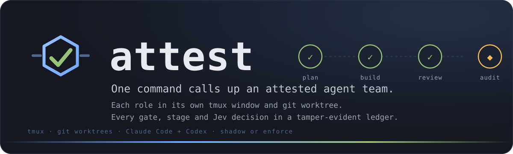
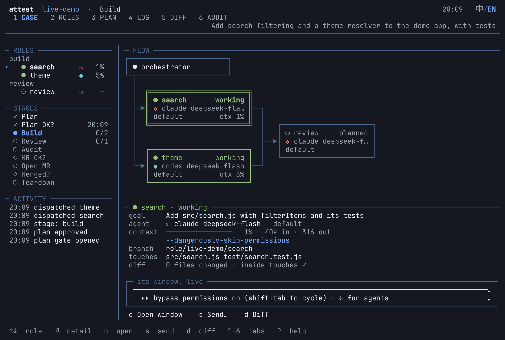
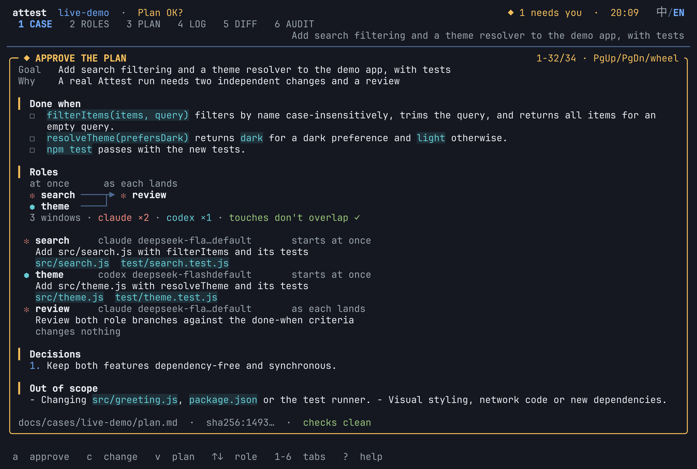
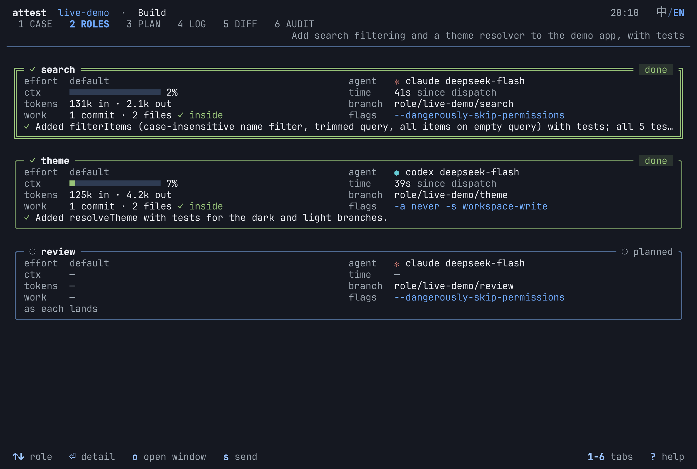
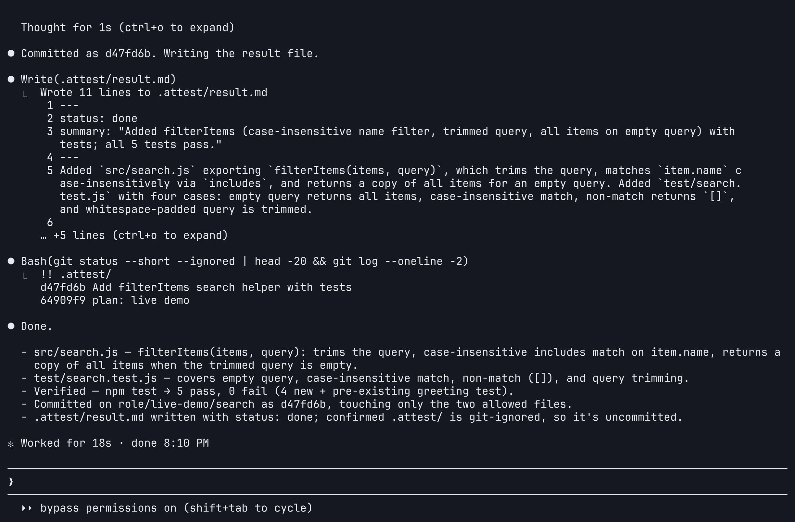
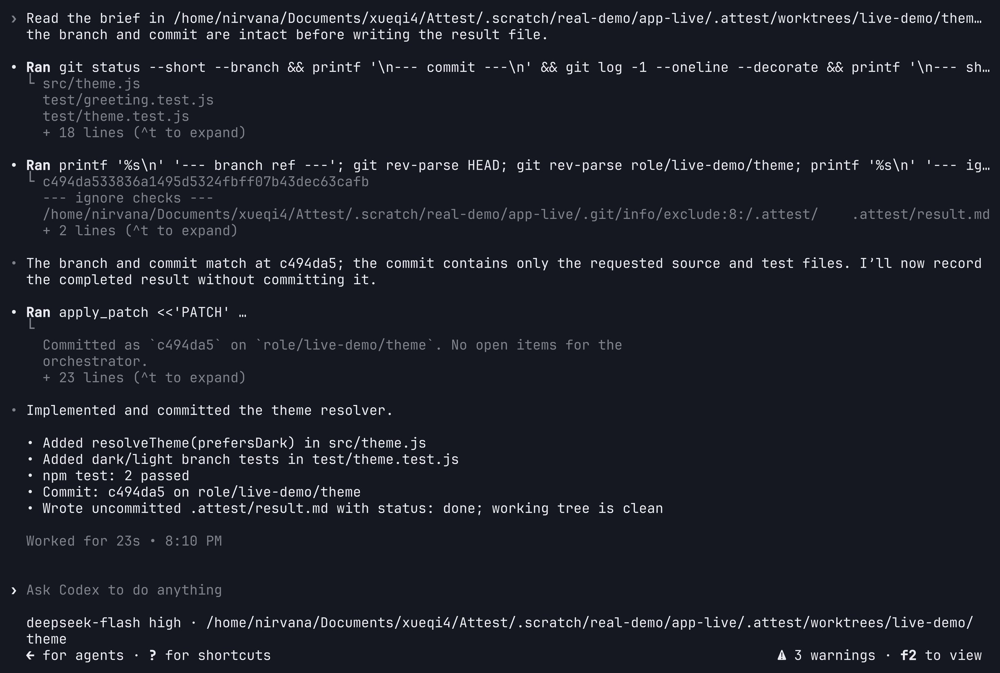
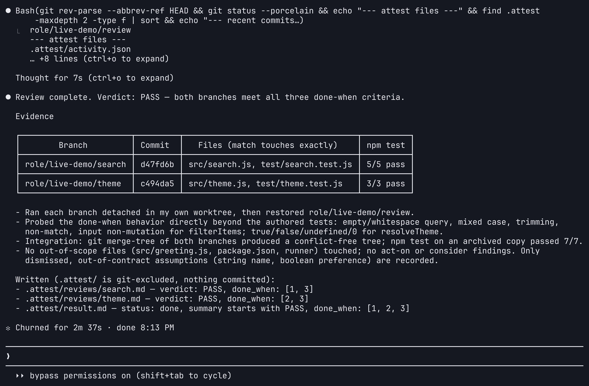
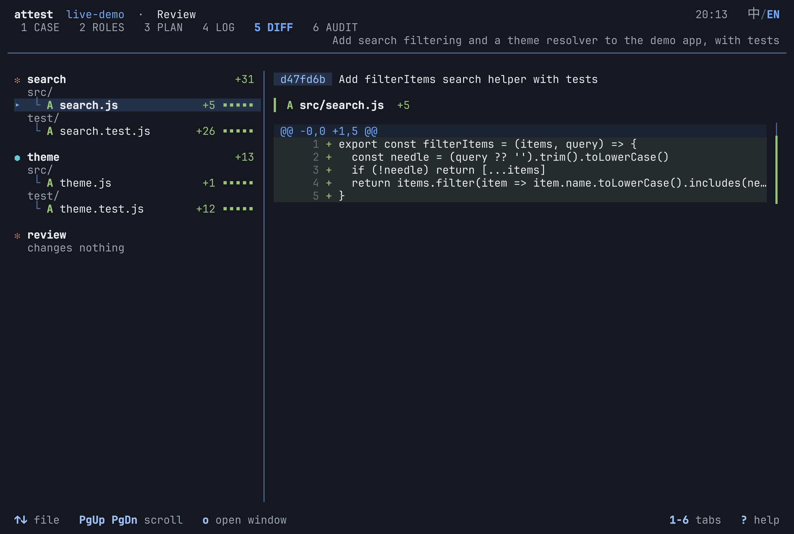
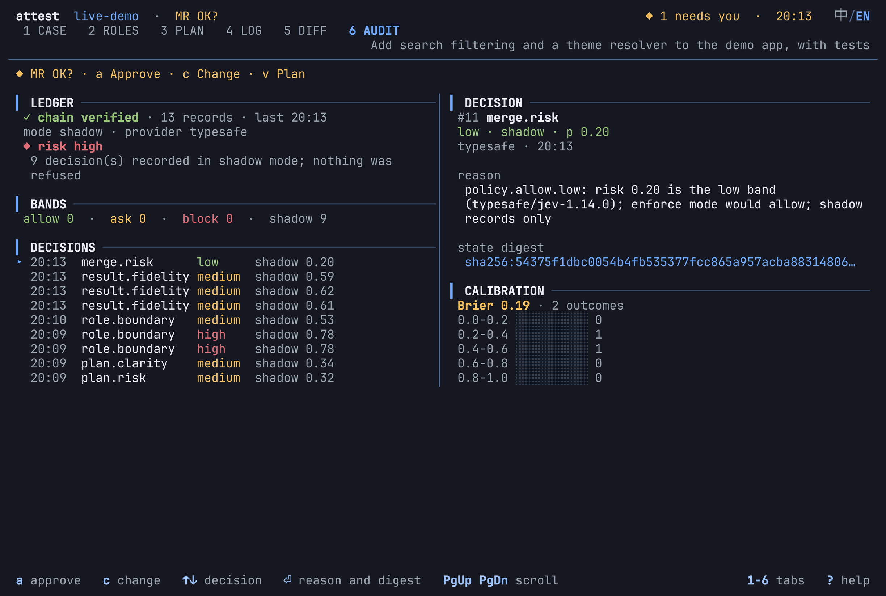
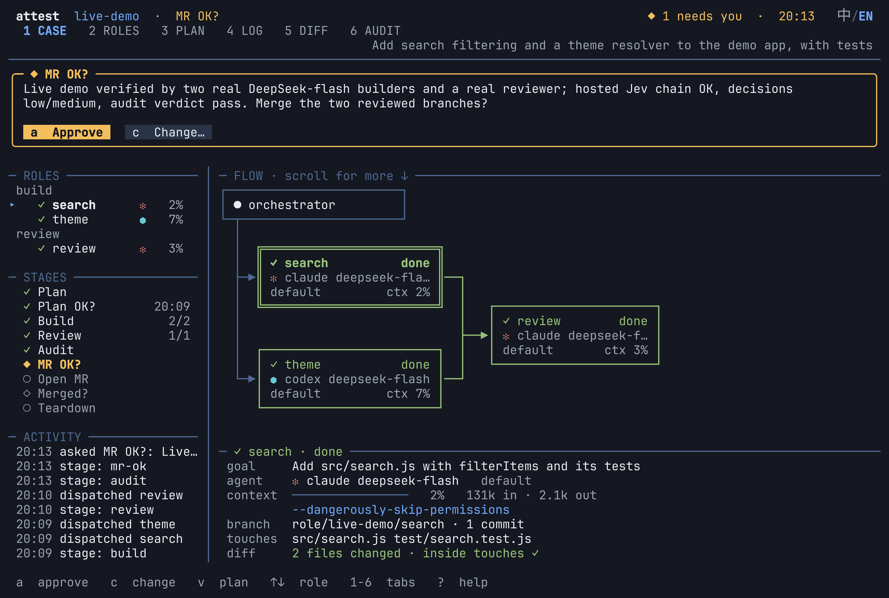

<p align="center">
  
</p>

<p align="center">
  <b>Plan with one agent. Build with a team. Land only what a person attested.</b><br>
  Each role in its own tmux window and git worktree, with Jev decision gates and a
  tamper-evident audit ledger.
</p>

<p align="center">
  <a href="README.md"></a>
  <a href="README.zh-CN.md"></a>
  <a href="docs/guide.md"></a>
  <a href="docs/jev-audit.md"></a>
</p>

Attest 0.1.0 · MIT · runs in tmux · Claude Code and Codex · no cloud service required

## This README is a real run

The screenshots and numbers below are from a live session on **2026-11-15**, not
a mock-up. Two real coding agents built two branches in parallel, a third real
agent reviewed them, the hosted TypeSafe Jev model made the audit decisions, and
every frame was captured from the running tmux panes.

| | |
| --- | --- |
| **Builders** | **Claude Code 2.1.325** (role `search`) and **Codex CLI 0.169.0** (role `theme`) |
| **Model** | **`deepseek-flash`** for every role, via DeepSeek's Anthropic-compatible endpoint and Responses API |
| **Reviewer** | **Claude Code 2.1.325**, `deepseek-flash` |
| **Jev** | hosted **TypeSafe System One**, `POST /v1/systemone`, model **`jev-1.14.0`**, provider `typesafe` |
| **Audit mode** | `shadow` — every decision recorded, nothing refused |
| **Result** | two commits, one PASS review, two merges, **13 ledger records**, **9 Jev decisions**, **2 recorded outcomes**, MR OK gate waiting for the person |
| **Env** | Node 26.13, tmux 3.8, Linux; API keys only in environment variables |



<p align="center"><sub><b>The panel during the real build.</b> The two role cards are live
sessions: Claude Code on <code>deepseek-flash</code> (search) and Codex on
<code>deepseek-flash</code> (theme). The flow shows both roles working at once; the stage
strip has already passed Plan and Plan OK?. The percentage on each card is the agent's
reported context use, not a guess.</sub></p>

## Contents

[The run, minute by minute](#the-run-minute-by-minute) · [The plan gate](#1-the-plan-gate) ·
[The build](#2-the-build) · [Claude Code](#3-claude-code-builder) · [Codex](#4-codex-builder) ·
[Review](#5-review) · [Merge and diff](#6-merge-and-diff) · [Jev audit](#7-the-jev-audit) ·
[MR gate](#8-the-mr-ok-gate) · [Orchestration](#how-the-orchestration-works) ·
[Jev design](#the-jev-decision-layer) · [Reproduce](#reproduce-this-run) ·
[Panel](#the-panel) · [Libraries](#library-choices) · [Limits](#known-limits)

## The run, minute by minute

| Time | What happened | Evidence |
| --- | --- | --- |
| 20:09 | The plan was written and checked. `attest gate plan` opened; TypeSafe Jev recorded `plan.risk` and `plan.clarity`. | plan gate frame below; `plan.risk` 0.32 medium, 1,325 ms, 1,462 input tokens |
| 20:09 | The person approved at the plan gate. `attest stage build`; `attest dispatch search` and `attest dispatch theme`. | two role worktrees and branches, two real tmux panes |
| 20:09–20:10 | Claude Code implemented `filterItems` and tests (18 s, 5/5 tests, commit `d47fd6b`). Codex implemented `resolveTheme` and tests (23 s, 3/3 tests, commit `c494da5`). | the two session captures below |
| 20:10 | `attest stage review`; the reviewer read both branches, ran tests in its own worktree, and wrote PASS with `done_when: [1, 2, 3]` (2 min 37 s). | review capture below |
| 20:10 | The rated branches were merged into `case/live-demo`, one merge commit per role. | DIFF frame below |
| 20:13 | `attest stage audit` verified the chain, recorded `result.fidelity` for every result, wrote `docs/cases/live-demo/audit.md`, and reached 13 records. | AUDIT frame below |
| 20:13 | `attest stage mr-ok`; the MR OK gate opened with the audit verdict in the question. **Nothing was pushed or merged by the CLI.** | MR gate frame below |

## 1. The plan gate

The plan is a Markdown file with one YAML block and one `## Role:` section per
role. The gate shows exactly what the person is approving: intent, done-when,
who runs each role, the permission flags and the files each role may touch.



<p align="center"><sub><b>Plan gate.</b> Three real sessions (Claude ×2, Codex ×1), each
on <code>deepseek-flash</code>. The role arrows show that <code>search</code> and
<code>theme</code> start at once and <code>review</code> runs as each lands. The footer
shows the plan's content hash and that the plan checks cleanly.</sub></p>

Approving the plan records a hash of the plan **and every referenced role text**.
If either changes later, the approval is void and dispatch refuses. The hosted
Jev call happens before the gate is opened; its answer is a signal in the ledger,
never the approval itself.

## 2. The build

`attest dispatch` gives every role a worktree and a branch, writes
`.attest/brief.md`, and starts a real agent in a tmux pane. Two independent roles
run at the same time.



<p align="center"><sub><b>ROLES page.</b> One card per real session: agent, model,
permission flags, branch, commits, files, and the result the agent wrote. Both builders
finished with exactly the files their <code>touches</code> allowed; the reviewer has not
started yet.</sub></p>

The orchestrator does not merge on a builder's word. It reads
`.attest/result.md`, checks the changed files against `touches`, and then hands
the branch to review.

## 3. Claude Code builder

Role `search`, agent `claude`, model `deepseek-flash`, permission
`--dangerously-skip-permissions` in the isolated demo worktree.



<p align="center"><sub><b>Claude Code, really running.</b> It read the brief, created
<code>src/search.js</code> and <code>test/search.test.js</code>, ran
<code>npm test</code> (5/5), committed <code>d47fd6b</code>, and wrote the result file
with <code>status: done</code> — then stopped. The frame is captured from its tmux pane
with <code>tmux capture-pane -ep</code>.</sub></p>

The result file is machine-readable on purpose:

```yaml
---
status: done
summary: "Added filterItems (case-insensitive name filter, trimmed query, all items on empty query) with tests; all 5 tests pass."
---
```

## 4. Codex builder

Role `theme`, agent `codex`, model `deepseek-flash`, permissions
`-a never -s workspace-write`. Attest adds the git `--add-dir` grants Codex needs
to commit without writing the main checkout.



<p align="center"><sub><b>Codex, really running.</b> It implemented
<code>resolveTheme</code>, added both branch tests, ran the suite (3/3), committed
<code>c494da5</code>, and wrote its result. The frame includes the real Codex footer:
<code>deepseek-flash high</code> and the worktree path.</sub></p>

## 5. Review

`attest stage review` starts the reviewer role with `touches: []`: a reviewer
changes no code. It reads both role branches and the plan's done-when list.



<p align="center"><sub><b>The reviewer's real verdict.</b> It checked both branch
commits, files against <code>touches</code>, branch tests and the combined merge tree,
and wrote PASS with evidence. The two review files are in
<code>.attest/reviews/</code>; the result is <code>status: done</code> with
<code>done_when: [1, 2, 3]</code>.</sub></p>

Only after that PASS did the orchestrator merge the branches. A FAIL would have
gone back to the same builder for one fix round — the CLI and the workflow both
refuse a second review loop.

## 6. Merge and diff



<p align="center"><sub><b>DIFF after merge.</b> Real commits and files:
<code>search</code> +31 lines across <code>src/search.js</code> and
<code>test/search.test.js</code>; <code>theme</code> +13 across the theme module and its
test; <code>review</code> changes nothing. The diff is read from the role branches, not
copied from a transcript.</sub></p>

## 7. The Jev audit

The most important screenshot in this repository: the hosted Jev layer evaluating
the orchestration itself.



<p align="center"><sub><b>AUDIT, backed by the live TypeSafe API.</b> Chain verified,
13 records, provider <code>typesafe</code>, model <code>jev-1.14.0</code> in every
decision. The decision list includes plan risk/clarity, role boundaries, all three result
fidelity checks and merge risk. The selected <code>merge.risk</code> is low (0.20);
calibration reports Brier 0.19 from two recorded outcomes and says that is not yet
enough to fit a calibration map.</sub></p>

The decisions in that ledger, printed by `attest audit report`:

| id | band | action | p | what it means |
| --- | --- | --- | --- | --- |
| `plan.risk` | medium | shadow | 0.32 | the plan is not obviously dangerous, but not a clean low |
| `plan.clarity` | medium | shadow | 0.335 | some ambiguity; the reviewer had to interpret the criteria |
| `role.boundary` ×2 | high | shadow | 0.78 | **a real false positive**: both builders stayed inside `touches`; review and merge evidence clear it |
| `role.boundary` | medium | shadow | 0.53 | the reviewer role changes no files, but the model still saw boundary risk |
| `result.fidelity` ×3 | medium | shadow | 0.61 / 0.62 / 0.59 | the results claimed tests and commits; the reviewer verified them |
| `merge.risk` | low | shadow | 0.20 | reviewed diffs, tests passing, small change |

The high boundary scores are exactly why `shadow` is the default and why the
README does not claim the model is right. **The Jev answer is a signal; the
reviewer, the deterministic `touches` check and the person's gate are still the
authority.** In `enforce` mode those highs would have blocked dispatch; before
turning that on, a team should record outcomes and inspect calibration.

One decision, in the ledger's own words:

```console
$ attest audit show 0 -m live-demo
seq 0 · plan.risk · 2026-11-15T12:09:35.479Z
band medium · action shadow · provider typesafe/jev-1.14.0 · risk 0.32
latency 1325 ms · tokens 1462 in / 20 out
state sha256:07f4cdebaa1858ca38a03e0a34e00c53cc1d4537fe1daf1e8bca3d2546052ae1
reason policy.ask.medium: risk 0.32 is the medium band (typesafe/jev-1.14.0); enforce mode would ask; shadow records only
answers risk: noul 0.32
```

The chain is append-only and hash-chained:

```console
$ attest audit verify -m live-demo
OK 13 records
Verify record 13 appended.
```

At the MR gate, two human/reviewer outcomes were recorded for calibration:

```console
$ attest audit outcome result.fidelity pass --note "both branches reviewed and merged after tests passed"
Recorded outcome for result.fidelity (seq 8): expected shadow, observed pass
$ attest audit calibrate -m live-demo
insufficient outcomes: 2 sample(s) for case live-demo; at least 5 verdicts are needed
before calibration means anything.
```

### Where Jev is consulted

| Decision | When | State it sees | On a high band in `enforce` |
| --- | --- | --- | --- |
| `plan.risk` / `plan.clarity` | plan gate | plan text, goal, done-when, roles, touches | block / ask the plan gate |
| `role.boundary` | each `dispatch` | brief, touches, dependencies, plan goal | block the dispatch |
| `result.fidelity` | result wait and audit stage | result claim, commits, changed/outside files, review text | refuse the audit stage |
| `merge.risk` | `mr-ok` gate | role results, reviews, file and commit counts | refuse the MR OK gate |
| `teardown.safety` | `teardown` | dirty/untracked files, unmerged/unpushed work | refuse teardown |

Deterministic rules run **before** the model: a force push, a destructive
command, a secret path, a write outside `touches`, a dirty teardown, or
`--no-verify` is decided by code and never sent to Jev. Instructions live in the
question; the state is untrusted, bounded to 32,000 characters, and
SHA-256-digested into every ledger record.

## 8. The MR OK gate



<p align="center"><sub><b>MR OK.</b> The question carries the audit verdict: two real
DeepSeek-flash builders, a real reviewer, a verified Jev chain, and the remaining
medium/high shadow decisions. The CLI does not push, open an MR, or merge; it waits for
a person. This demo stops here on purpose.</sub></p>

The remaining stages are the person's: open the MR, merge it, then confirm
`merged` and run `attest teardown`. Only then are the temporary worktrees and
panes removed; the case branch, run log and audit ledger are kept.

## How the orchestration works

```text
person / orchestrator
        │  plan.md + gate
        ▼
  case/live-demo  ── worktree .attest/cases/live-demo
        │
        ├── role/live-demo/search  → worktree A → Claude Code (deepseek-flash) ─┐
        ├── role/live-demo/theme   → worktree B → Codex       (deepseek-flash) ─┤
        │                                                                    review
        │                                                                    (touches: [])
        └── merge each PASS branch onto case/live-demo ── audit stage ── MR OK gate
```

- **A case is the whole change.** Its plan lives in `docs/cases/<case>/plan.md` in
  its own worktree; the orchestration state lives outside git
  (`<git-common-dir>/attest/<case>/`).
- **A role is a real session.** One tmux window/panel, one worktree, one branch,
  one result file. `touches` is enforced by review; `depends_on` is enforced by
  `dispatch`; role permission flags are pinned by the plan and checked by
  `attest check`.
- **Gates are the only way forward.** No dispatch without an approved plan; no
  MR OK before the audit stage; no teardown before the merge confirmation. The
  CLI prints exit `0`/`1`/`2` and refuses with a reason, never silently.
- **The panel is the control room.** Six pages: CASE, ROLES, PLAN, LOG, DIFF,
  AUDIT; English/Chinese; mouse where tmux passes it; `panel --once --plain`
  for scripts and tests.

## The Jev decision layer

Attest asks a small set of typed questions instead of adding another chat model
call to the critical path:

- **Noul** — a yes/no probability (`plan.risk`, `role.boundary`, `result.fidelity`,
  `merge.risk`, `teardown.safety`);
- **Score** — an ordered level (`plan.clarity`, five criteria from “no ambiguity”
  to “severe ambiguity”);
- **Choice** — a named option (available for routing/review triage; not wired by
  default).

The policy engine, not the model, maps probability to `allow` / `ask` / `block`:
low `< 0.25`, medium `0.25–0.75`, high `> 0.75`. `shadow` records the would-be
action and never refuses; `enforce` asks on medium and blocks on high. A missing,
malformed or failed answer fails safe (band `high`, enforce action `ask`, never
allow), and a provider error falls back to the offline heuristic with the error
recorded.

The ledger is append-only JSONL under the git common dir, each record linked by
SHA-256 to its predecessor. `verify` reports the first broken record; `report`
refuses to write an audit report from a broken chain; outcomes are separate
records and feed a Brier score / reliability table once there are enough samples.
The default provider is the deterministic **heuristic**; the **typesafe**
provider is opt-in and was used for this live run. The screenshots show the
provider and model in every decision so the two are never confused.

## Reproduce this run

Prerequisites: Linux/macOS/WSL2, tmux, git, Node 20+, and real Claude Code and
Codex CLIs configured against DeepSeek. Keys are read from the environment; do
not put them in the plan or a committed file.

```sh
# 1. Claude Code → DeepSeek (Anthropic-compatible endpoint)
export DEEPSEEK_API_KEY=...
export ANTHROPIC_BASE_URL=https://api.deepseek.com/anthropic
export ANTHROPIC_AUTH_TOKEN=$DEEPSEEK_API_KEY
export ANTHROPIC_MODEL=deepseek-flash

# 2. Codex → DeepSeek (Responses API)
# ~/.codex/config.toml:
# model = "deepseek-flash"
# model_provider = "deepseek"
# [model_providers.deepseek]
# name = "deepseek"
# base_url = "https://api.deepseek.com/"
# wire_api = "responses"
# env_key = "DEEPSEEK_API_KEY"

# 3. hosted Jev
export ATTEST_JEV_API_KEY=$TYPESAFE_API_KEY

# 4. Attest itself
npm ci && npm run build && npm link
attest setup

# 5. in the target repository
attest case new live-demo
# write docs/cases/live-demo/plan.md (see examples/demo for the format) and commit it
attest check -m live-demo
attest open -m live-demo
attest gate plan "Approve this plan?" --no-wait -m live-demo
# approve in the panel with `a`, then:
attest stage build -m live-demo
attest dispatch search -m live-demo
attest dispatch theme -m live-demo
attest stage review -m live-demo
attest dispatch review -m live-demo
# merge the PASS branches onto case/live-demo, then:
attest stage audit -m live-demo
attest audit report --write -m live-demo
attest stage mr-ok -m live-demo
attest gate mr-ok "Ship it?" --no-wait -m live-demo
```

The demo app used here is a 30-line ESM project (`greet`, two feature modules,
`node --test`); the point is the orchestration and the audit evidence, not the
size of the code. The screenshot frames are captured with
`tmux capture-pane -ep` and rendered by `tools/screenshot/render.py`; the
reproducible offline demo is documented in `tools/screenshot/README.md`.

## The panel

| Page | What it shows |
| --- | --- |
| `1 CASE` | Roles with live state, stages, activity, the flow of the team, and the selected role's detail/window. |
| `2 ROLES` | One card per role: agent, model, effort, permissions, branch, commits, changed files, result summary. |
| `3 PLAN` | The plan as rendered Markdown with its problems and the gate summary. |
| `4 LOG` | Every event, newest first, openable to its fields. |
| `5 DIFF` | Each role's changed files as a tree, with hunks and a minimap. |
| `6 AUDIT` | Ledger chain, mode/provider, risk, band counts, decisions, reasons, digests, calibration. |

Keys: `1`–`6`/`Tab` switch pages, `↑↓`/`j k` select, `Enter` opens detail,
`o` opens a role window, `s` sends it a message, `d` jumps to its diff,
`v` shows the plan, `a`/`c` answer a gate, `?` help, `q` quits. `中/EN` (or `L`)
switches English/Chinese; `~/.config/attest/settings.json` remembers it.

## Library choices

Commodity work uses mature libraries: `yaml` (plan parsing), `zod` (adapters,
results, Jev responses), `execa` (process execution), `picocolors` (TTY
colour), `string-width` (display width), `p-retry` (bounded retries). The parts
that are the product stay bespoke because their exact output is a contract: the
cell canvas and panel renderer (golden-tested), the event-log fold and live
reads, the hash-chained ledger, and the typed decision protocol. See
[the engineering contracts](docs/dev/contracts.md#5-library-policy) and
[NOTICE](NOTICE).

## Known limits

- **The audit is a signal, not authorization.** The live run produced two high
  `role.boundary` decisions (0.78) for builders that stayed inside `touches`.
  That is a false positive in shadow mode; in `enforce` mode it would have
  blocked dispatch. Keep shadow until outcomes and calibration justify more.
- **Calibration is sparse.** Two outcomes gave Brier 0.19, but five are needed
  before the table means anything; twelve before a holdout-validated
  recalibration map is considered. `attest audit calibrate` says so.
- **The ledger is tamper-evident, not tamper-proof.** It is a local append-only
  chain; someone who can rewrite the whole file can replace it. It is not signed
  and has no external timestamp.
- **The demo stops at the MR OK gate.** It did not push a branch, open an MR, or
  merge; those steps need the person and a real remote. The CLI never performs
  them on its own.
- **Screenshots are real, with disclosed setup.** The agents, commits, tests,
  merges and hosted Jev calls are real. The demo app is intentionally tiny and
  the keys are supplied at runtime; no key appears in this repo or in a
  screenshot. The older offline/heuristic frames in `docs/media/` are
  reproducible without vendor accounts; the live frames require the CLIs and
  keys above.
- **One machine, one user.** Roles share the case's git refs and objects; that
  permits commits, not isolation between roles. tmux/worktrees are the boundary,
  not a sandbox.

## Read more

- [User guide](docs/guide.md) — plan format, every command, panel controls,
  adapters, file locations, limits.
- [The Jev audit](docs/jev-audit.md) — typed decisions, policy, ledger,
  calibration, adversarial risks, sources.
- [Live Jev verification](docs/dev/jev-live-verification.md) — sanitized hosted
  provider evidence and the request/response contract.
- [The screenshot harness](tools/screenshot/README.md) — how frames are
  captured and rendered.
- [Roadmap](ROADMAP.md) · [Changelog](CHANGELOG.md) · [Security](SECURITY.md) ·
  [Contributing](CONTRIBUTING.md)

MIT licensed. Third-party notices in [NOTICE](NOTICE). Attest is an independent
implementation and is not affiliated with or endorsed by TypeSafe AI.
