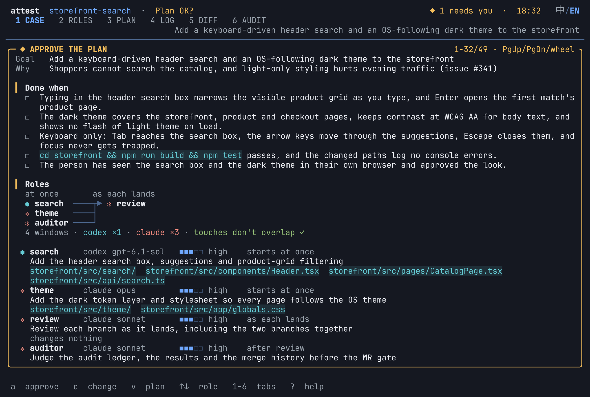
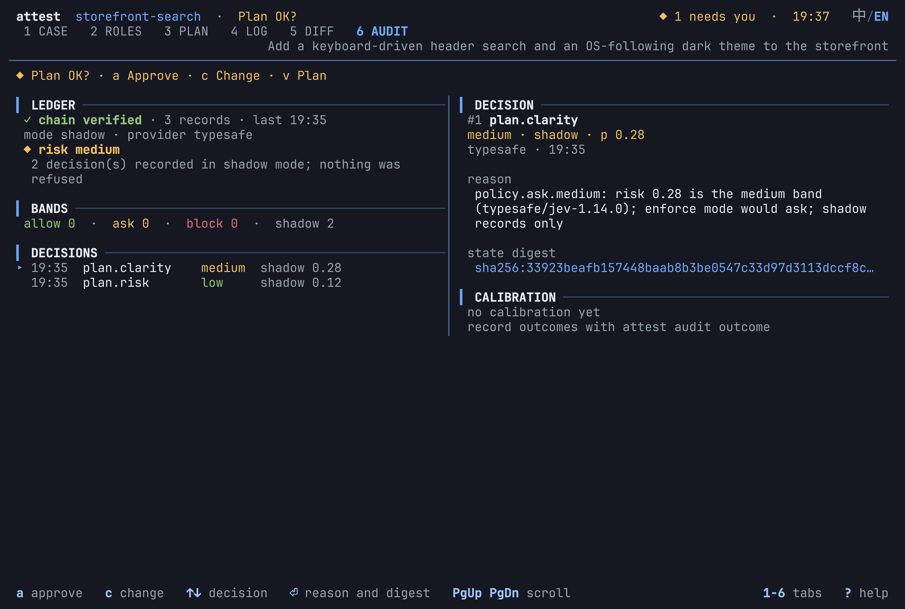
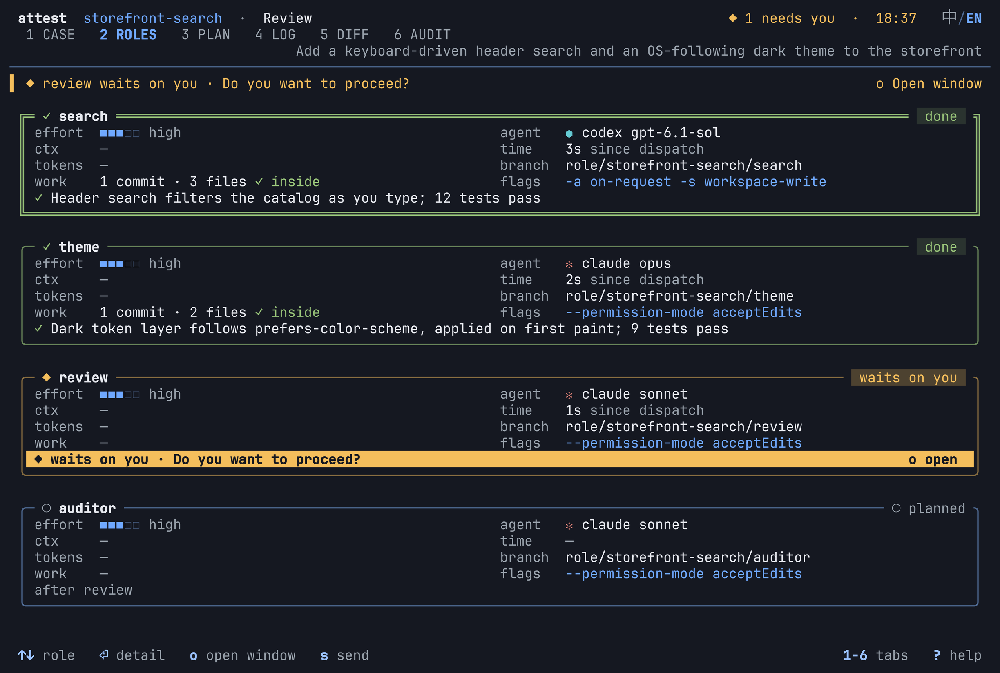

<p align="center">
  
</p>

<p align="center">
  <b>Plan with one agent. Build with a team. Land only what a person attested.</b><br>
  Each role in its own tmux window and git worktree, with Jev-style decision gates and a
  tamper-evident audit ledger.
</p>

<p align="center">
  <a href="README.md"></a>
  <a href="README.zh-CN.md"></a>
  <a href="docs/guide.md"></a>
  <a href="docs/jev-audit.md"></a>
</p>

Attest 0.1.0 · MIT · runs in tmux · Claude Code and Codex · no cloud service required

## Why Attest

- **See the team, and step in.** Every role is a real Claude Code or Codex session in a
  tmux window. One panel shows who is working, who needs you, what each branch changed
  and what it claimed. Jump into any role's window to read along or answer it.
- **Agree before work starts.** The orchestrator writes a plan; you approve it in the
  panel. Roles get their own git worktree and branch cut from the case branch, and
  planned file overlaps require an explicit order.
- **Different agents, one gate.** Mix Claude Code and Codex, models and effort per role.
  The default workflow has a reviewer check each branch as it lands, and stops for you
  before the MR and before cleanup.
- **Decisions you can audit.** An optional Jev/System One decision layer rates plan
  risk, role boundaries, result fidelity, merge risk and teardown safety. Each rating
  lands in a hash-chained ledger; `attest audit verify` checks the chain and
  `attest audit report` writes the evidence the MR gate rests on. Signals stay signals:
  the ledger never authorizes a merge.

<p align="center">
  
  <br>
  <sub><b>The case page</b> — two builders done, the reviewer waiting on you, the audit stage ahead.
  Captured from the real panel process; see <a href="tools/screenshot/">tools/screenshot</a>.</sub>
</p>

> **What is real in these frames.** The panel, CLI, git worktrees, commits, run log
> and audit ledger are real Attest output. The agent sessions are scripted demo
> adapters (`tools/screenshot/demo/agent.mjs`) so the frames reproduce without a
> signed-in Claude Code or Codex; the role and model labels come from the demo
> plan's adapter fields. The audit frames use the default offline `heuristic`
> provider, not the hosted Jev API.

## Quick start

You need **macOS, Linux or WSL2**, **tmux**, **Node.js 20+**, **git**, and **Claude Code
and/or Codex** installed and signed in.

```sh
git clone <repo> && cd Attest
npm ci && npm run build && npm link   # Attest 0.1.0 is not published to npm; build from source
attest setup                          # installs the case workflow for the harnesses it finds
```

Open Claude Code or Codex **inside tmux, in the repository you want to change**, and ask:

```text
Run this as an attest case: add a header search box that filters the catalog as you
type, and a dark theme that follows the system setting.
```

The agent writes the plan and opens the panel beside it. Read the plan, press **`a`** to
approve or **`c`** to request changes; roles start only after approval.

Prefer a terminal-first start? Run this in the repository you want to change:

```sh
attest up -m storefront-search --orch claude
```

It creates the case worktree, starts the orchestrator in it, and opens the panel.

## From one case to a merged change

1. **Plan together.** The orchestrator reads the code and writes
   `docs/cases/<case>/plan.md`: goal, why, done-when, out-of-scope, decisions for you,
   and the role split with each role's agent, model, permissions and `touches`.
2. **Approve the plan.** The panel shows the plan gate. Approving takes your decisions'
   recommendations; a change sends your words back to the orchestrator. Any later edit
   of the plan or a referenced role text needs approval again.
3. **Build in parallel.** Independent roles open at once in their own windows and
   worktrees; dependent roles wait for `done` dependencies. Builders commit on their own
   branch and write a result file the panel and CLI can read.
4. **Review each branch.** A reviewer checked against a different model reads the diffs
   and the done-when criteria, and gives one fix round before the orchestrator rules.
5. **Audit before the MR.** The audit stage verifies the ledger, records result
   decisions and writes `docs/cases/<case>/audit.md`. In `shadow` mode nothing is
   refused; in `enforce` mode a high risk blocks and a medium one asks.
6. **You gate the handoff.** `mr-ok` is asked before anything is pushed. You merge the
   MR yourself, confirm the `merged` gate, and only then does `attest teardown` remove
   the case's windows and temporary worktrees.

<p align="center">
  
  <br>
  <sub><b>The plan gate</b> — the same frame a person approves: goal, why, done-when, the
  split with each role's agent and effort, and the decisions that approving accepts.</sub>
</p>

## The decisions, and the ledger

Most multi-agent tools stop at "the agent said it is done". Attest adds a second
question: *should this have happened, and can you prove afterwards what was decided?*

The optional `audit:` block in a plan turns on a Jev/System One decision layer:

```yaml
audit:
  mode: shadow          # shadow records only; enforce lets high risk block
  provider: heuristic   # offline and deterministic by default; typesafe calls the API
  questions: [plan.risk, plan.clarity, role.boundary, result.fidelity, merge.risk, teardown.safety]
```

Every decision is appended to a hash-chained ledger
(`<git-common-dir>/attest/<case>/audit.jsonl`), and every recorded decision can be
checked later:

```sh
attest audit verify          # OK <n> records, or BROKEN at record <n>
attest audit report --write  # the case summary; writes docs/cases/<case>/audit.md
attest audit show 3          # one decision with its reason and state digest
attest audit outcome result.fidelity pass
attest audit calibrate       # Brier score and reliability bins, once outcomes exist
```

Three design rules keep this honest. **Deterministic rules win**: a force push, a
destructive command, a secret path or a write outside `touches` is decided by a regex
and the model is not consulted. **Answers are signals, never authorization**: gates,
permissions and review still decide, and a provider error fails safe (ask, never
allow). **The provider is your choice**: the offline heuristic is the default; the
HTTP provider is opt-in, bounded and logged.

### See it run, and what the screenshots use

The screenshots and a default install use `provider: heuristic`: a deterministic,
offline provider behind the same typed-decision contract. It is **not** the hosted
Jev model, and every decision records `provider: heuristic` so the two cannot be
confused. An abridged run on the demo case:

```sh
$ attest gate plan "Approve the search and dark-theme plan" --no-wait -m storefront-search
Opened gate plan
$ attest audit verify -m storefront-search
OK 2 records
Verify record 2 appended.
$ attest audit report -m storefront-search
# Audit: storefront-search

- Chain: OK 3 records
- Mode: shadow · provider: heuristic
- Decisions: 2 · allow 0 · ask 0 · block 0 · shadow 2
- Bands: low 1 · medium 0 · high 1 · unknown 0
- Risk: high
- Verdict: 2 decision(s) recorded in shadow mode; nothing was refused
```

In `enforce` mode a high band stops the gate. With `git push --force origin main`
written into a role's brief, the deterministic pre-check wins and the ledger says
so (the ledger was reset between the two excerpts; paths and hashes are trimmed):

```sh
$ ATTEST_JEV_MODE=enforce attest gate plan "Ship it?" --no-wait -m storefront-search
plan gate: audit plan.clarity: high 0.93 (heuristic) → block: policy.block.high: …
# exit 1
$ attest audit show 0 -m storefront-search
seq 0 · plan.risk · …
band high · action block · provider precheck · risk —
state sha256:…
reason precheck.force-push: state names a force push; the deterministic rule decides, the model is not consulted
```

A live hosted run (2026-11-15, key supplied at runtime; this ledger is separate
from the heuristic excerpts above) records the versioned model, latency and token
usage:

```sh
$ ATTEST_JEV_PROVIDER=typesafe ATTEST_JEV_API_KEY=… attest gate plan "Live Jev check" --no-wait -m storefront-search
Opened gate plan
$ attest audit show 0 -m storefront-search
band low · action shadow · provider typesafe/jev-1.14.0 · risk 0.12
latency 639 ms · tokens 2726 in / 20 out
$ attest audit show 1 -m storefront-search
band medium · action shadow · provider typesafe/jev-1.14.0 · risk 0.28
latency 250 ms · tokens 2762 in / 17 out
answers risk: score 0.28 (confidence 0.62)
```

<p align="center">
  
  <br>
  <sub><b>A live hosted Jev decision</b> — captured from the real panel on 2026-11-15:
  `provider: typesafe`, `model jev-1.14.0`, `plan.clarity` medium at 0.28. The key was
  supplied at runtime and never stored; unlike the five reproducible frames above,
  this capture needs a TypeSafe credential to recreate.</sub>
</p>

To call the hosted TypeSafe System One endpoint, keep `mode: shadow`, set
`ATTEST_JEV_PROVIDER=typesafe` and `ATTEST_JEV_API_KEY` (optionally
`ATTEST_JEV_BASE_URL` and `ATTEST_JEV_MODEL`), record a few
`attest audit outcome` verdicts, then move to `enforce` once the report's
calibration is meaningful. The provider has been live-verified against
`POST /v1/systemone` (`jev-1.14.0`); the sanitized evidence is in
[docs/dev/jev-live-verification.md](docs/dev/jev-live-verification.md). The
request/response contract, its caveats and the full command reference are in
[the Jev audit guide](docs/jev-audit.md).

<p align="center">
  
  <br>
  <sub><b>The AUDIT page</b> — chain status, mode and provider, the risk verdict, band
  counts, every decision with its probability, the selected reason and state digest,
  and calibration bars once outcomes are recorded.</sub>
</p>

Read [docs/jev-audit.md](docs/jev-audit.md) for the full design: the typed decision
protocol, the policy, the trust boundary, what attestation does and does not prove, and
the published evidence behind the approach — including its calibration and adversarial
caveats.

## The panel

| Page | What it shows |
| --- | --- |
| `1 CASE` | Roles with live state, stages, activity, the flow of the team, and the selected role's detail and live window. An open gate or each role waiting on you appears at the top. |
| `2 ROLES` | One card per role: agent, model, effort, permissions, branch, commits, changed files, result summary. |
| `3 PLAN` | The plan as rendered Markdown with its problems, plus the summary the gate uses. |
| `4 LOG` | Every event of the run, newest first, openable to its fields. |
| `5 DIFF` | Each role's changed files as a tree, with hunks and a minimap. |
| `6 AUDIT` | The ledger: chain, mode/provider, risk, band counts, decisions, reasons and calibration. |

Keys: `1`–`6` or `Tab` switch pages, `↑↓`/`j k` select, `Enter` opens the detail, `o`
opens a role's window, `s` sends it a message, `d` jumps to its diff, `v` shows the
plan, `a`/`c` answer a gate, `?` shows help, `q` quits. `中/EN` (or `L`) switches the
panel between English and Chinese and is remembered in `~/.config/attest/settings.json`;
role windows and the languages agents write in follow that choice. Clicks work where
tmux passes the mouse.

<p align="center">
  
  <br>
  <sub><b>The ROLES page</b> — the same run, one card per role. Ctx and tokens appear when
  the harness reports them; a role with a result is done even if its window is idle.</sub>
</p>

<p align="center">
  
  <br>
  <sub><b>中文界面</b> — labels, gates and help switch to Simplified Chinese; role names, branches,
  commands and what attest reads back stay in English.</sub>
</p>

## Commands

Every command takes `-m, --case <name>`; without it a command acts on the case bound to
the pane it runs in, else on the case branch checked out there. Exit codes: `0` success,
`1` refused with the reasons, `2` usage.

| Command | What it does |
| --- | --- |
| `attest setup [--remove]` | install or remove the case workflow for each harness found |
| `attest case new <name> [--base <ref>]` | create the case worktree on `case/<name>` with a plan template, bind this pane, open its panel |
| `attest open [--planning] [-m case]` | show the case's panel beside this agent |
| `attest up -m <case> [--orch claude\|codex]` | create the case, start the orchestrator in its worktree, open the panel |
| `attest check [case\|folder\|plan]` | check a plan and the repository's agent adapters |
| `attest approve [-m case]` | approve the plan from a terminal (the panel's `a` does the same) |
| `attest gate <id> ["question"] [--no-wait]` | ask the person in the panel |
| `attest stage <id>` | move the stage strip (ids from the workflow's `stages.yaml`) |
| `attest dispatch <role>` | open a role: worktree, branch, brief, window |
| `attest status [--json] [--watch]` | each role's state, commits, files outside `touches`, result |
| `attest send <role> <text…>` | type into a role's window when it is ready |
| `attest wait --role <r> [--ready] \| --gate <id> [--timeout s]` | wait for a result, readiness or a gate answer |
| `attest close <role> \| --all` | close attest's panes; worktrees and branches stay |
| `attest panel [--once] [--plain] [--no-anim] [--width N --height N]` | the live panel |
| `attest audit verify\|report\|show\|outcome\|calibrate` | the audit ledger: check, report, inspect, record outcomes, calibrate |
| `attest teardown [--force]` | remove case panes, role worktrees and branches after the gates allow it |

## Agents and adapters

Built in: **Claude Code** and **Codex**. An adapter describes how to start the agent,
pass model and effort, pin its permission, and read its screen; add one as
`~/.config/attest/agents/<name>.yaml` or `<repo>/.attest/agents/<name>.yaml` (the
repository's wins). Each role's `flags` must pin its agent's permission — Claude Code
`--permission-mode acceptEdits`, Codex `-a on-request -s workspace-write` — so a role
never inherits a permission mode from your shell. Claude Code roles get lifecycle hooks
(`UserPromptSubmit`, `PermissionRequest`, `PostToolBatch`, `Stop`, `Notification`) and a
status line for context use; Codex roles are read from their own session log. The
[user guide](docs/guide.md#agent-adapters) documents the adapter fields and the fallbacks.

## Library choices

Commodity work uses mature libraries, and each one earns its place: `yaml` for plan
parsing, `zod` for adapter and decision-response validation, `execa` for process
execution, `picocolors` for terminal colour, `string-width` for display width, and
`p-retry` for bounded retries of idempotent calls. The parts that are the product stay
bespoke because their exact output is a contract: the cell canvas, motion and panel
renderer (its plain-text goldens are tested), the event-log fold and live state reads,
the hash-chained ledger, and the typed decision protocol. See
[docs/dev/contracts.md](docs/dev/contracts.md#5-library-policy) and [NOTICE](NOTICE).

## Known limits

- **The ledger is tamper-evident, not tamper-proof.** It is a local append-only chain;
  someone who can rewrite the whole file can replace it. It is not signed and has no
  external timestamp.
- **The heuristic is not Jev.** The default provider is Attest's own deterministic
  scoring, labelled `provider: heuristic`. Calibration is measured per case from
  recorded outcomes and is sparse at first; `audit calibrate` says so rather than
  guessing.
- **The screenshots are not vendor sessions.** The panel frames are real CLI
  output, but the agent binaries in them are scripted adapters and the audit
  decisions come from the offline heuristic. They demonstrate the product surface,
  not Claude Code, Codex or the hosted Jev model under load.
- **Decision models can be attacked.** Published work shows prompt injection and
  adversarial suffixes can manipulate Jev-style decisions. Attest keeps instructions
  out of the state, prefers deterministic rules, and fails safe — but do not feed
  secrets or untrusted content to a remote provider.
- **Screen patterns are a fallback.** A built-in role's turn is decided by the agent's
  own signal (hooks or session log), not by its screen; the screen only tells a waiting
  dialog from working, and an unrecognised screen is `unknown` and never typed into.
- **One machine, one user.** Roles share the case's refs and objects; that allows
  commits, not isolation between roles. tmux and git worktrees are the boundary, not a
  sandbox.
- **A plan needs approval, and approval needs a terminal.** Panel `a` or
  `attest approve`; nothing is pushed or merged by the CLI.

## Development

```sh
git clone <repo> && cd Attest
npm ci
npm run build && npm link   # puts your Attest build on the PATH
./check.sh                  # type-check, build, every test, identity scan
```

`./check.sh` runs `tsc`, the identity scan and the full `node:test` suite, including
panel goldens and real-tmux integration tests (they skip when tmux is absent). To
regenerate panel goldens deliberately: `UPDATE_GOLDENS=1 node --test tests/draw.node.mjs`
and read the diff. Screenshots in `docs/media/` are produced by
[tools/screenshot](tools/screenshot/README.md): a real `attest panel` process in tmux,
captured with `tmux capture-pane -ep` and rendered to PNG. Contributions: see
[CONTRIBUTING.md](CONTRIBUTING.md).

## Read more

- [User guide](docs/guide.md) — plan format, every command and option, panel controls,
  adapters, where files live, limits.
- [The Jev audit](docs/jev-audit.md) — typed decisions, policy, ledger, calibration,
  adversarial caveats, sources.
- [Roadmap](ROADMAP.md) · [Changelog](CHANGELOG.md) · [Security](SECURITY.md) ·
  [Contributing](CONTRIBUTING.md)

MIT licensed. Third-party notices in [NOTICE](NOTICE). Attest is an independent
implementation and is not affiliated with or endorsed by TypeSafe AI.
