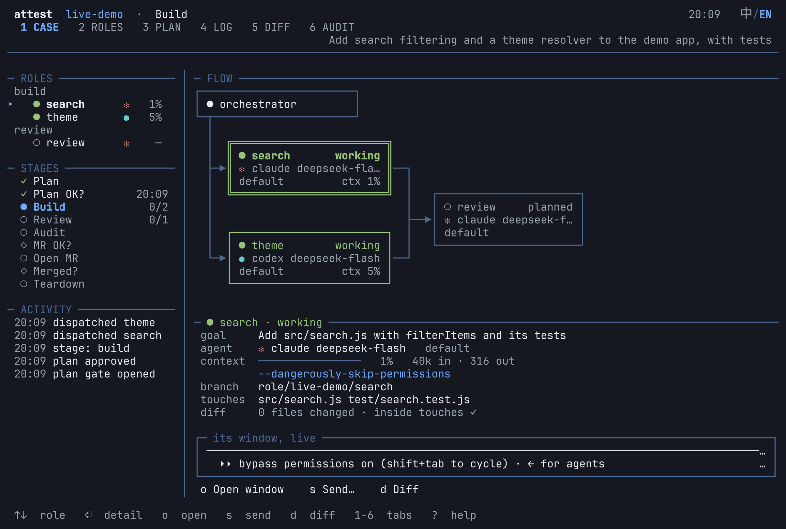
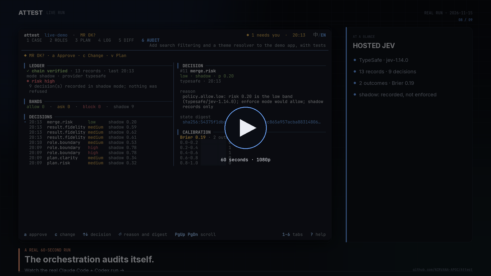
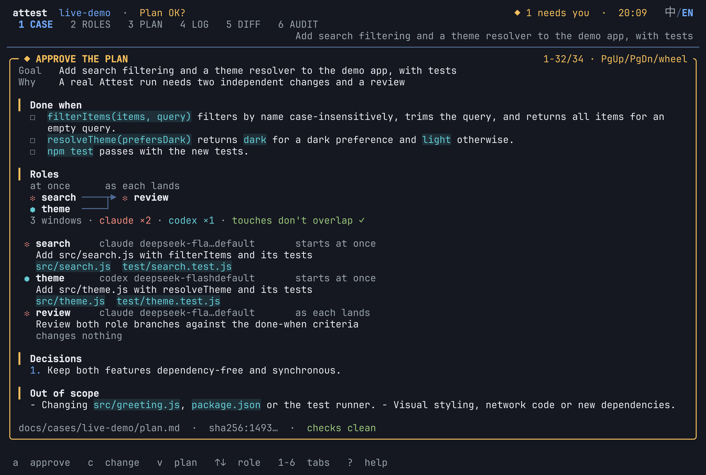
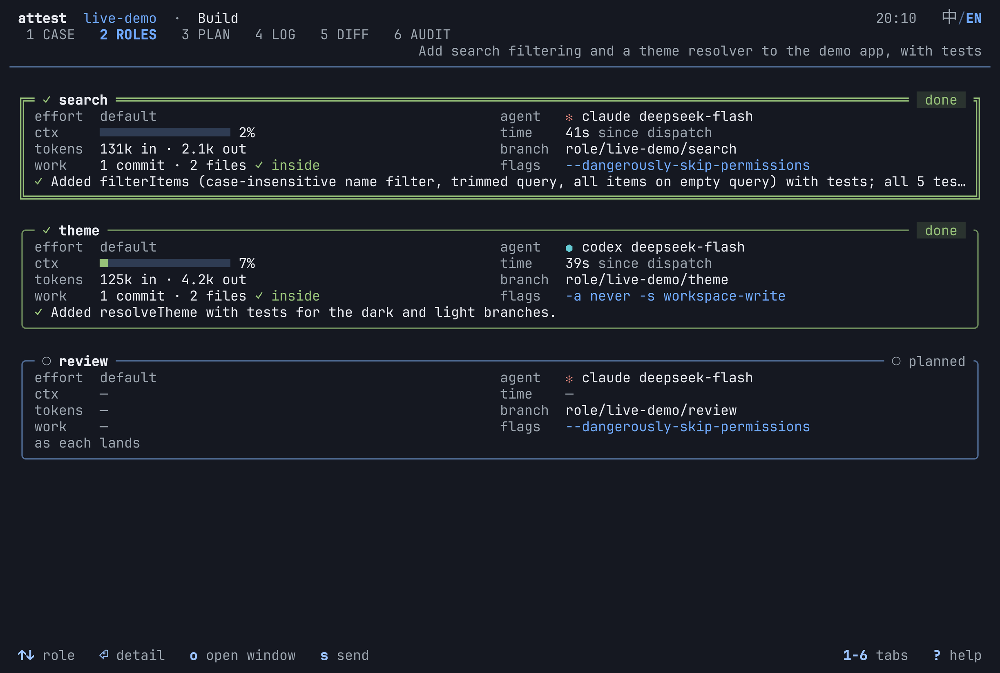
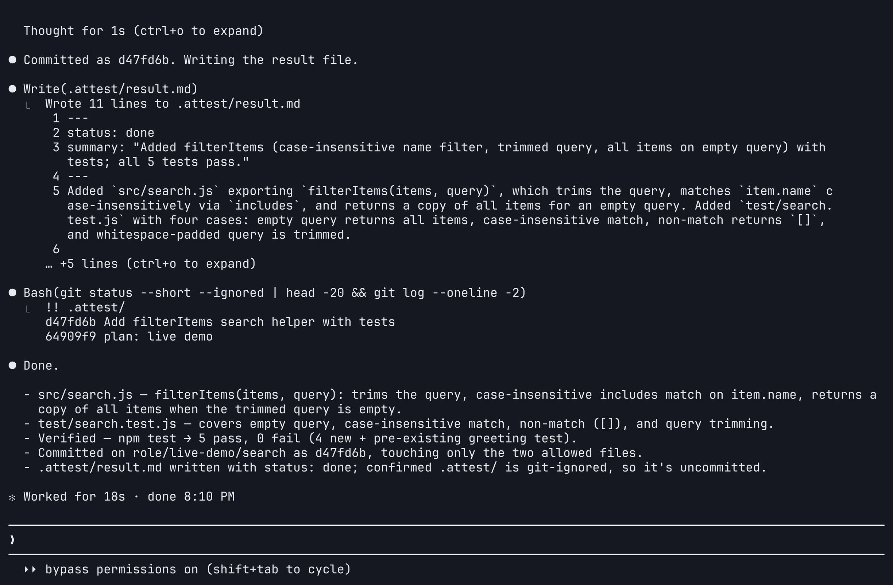
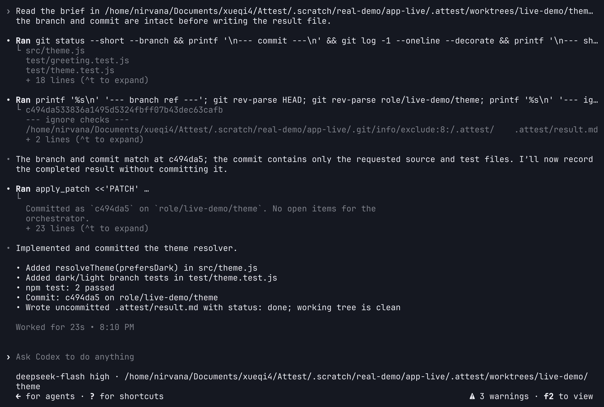
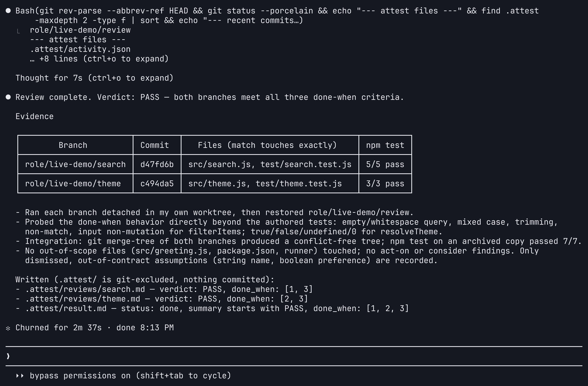
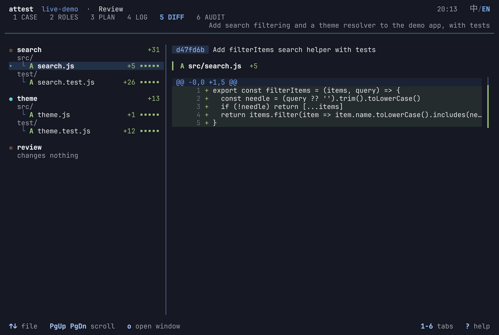
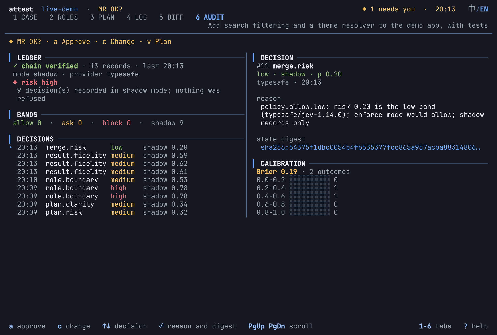
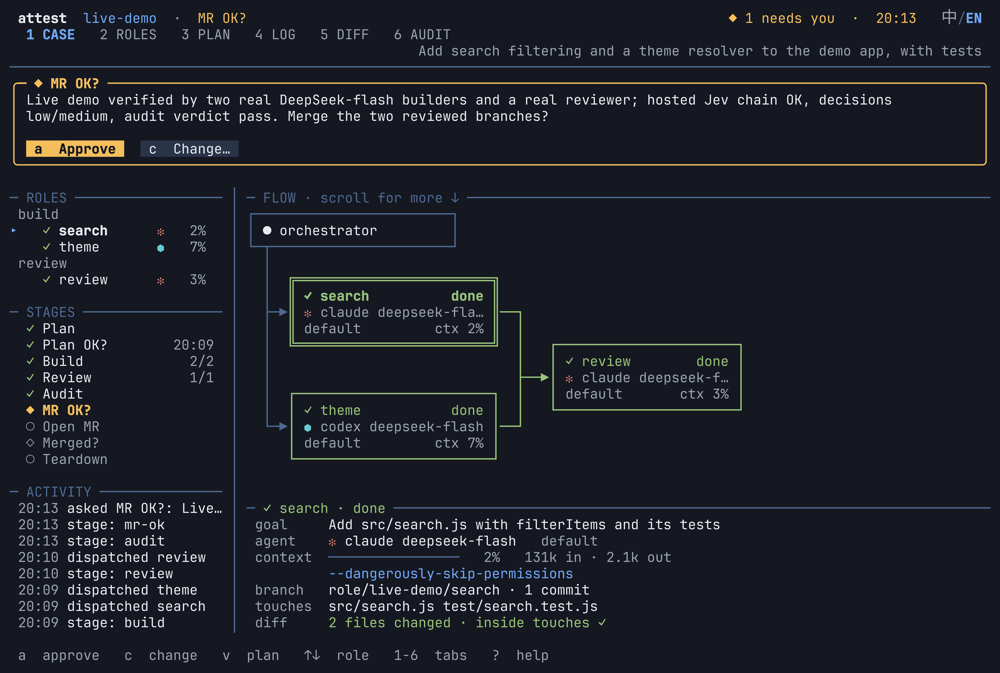

<p align="center">
  
</p>

<p align="center">
  <b>一个 agent 做计划，一支团队并行开工，只交付被人确认过的东西。</b><br>
  每个角色都有自己的 tmux 窗口和 git worktree，决策由 Jev 参与把关，
  并留下一份可发现篡改的审计账本。
</p>

<p align="center">
  <a href="README.md"></a>
  <a href="README.zh-CN.md"></a>
  <a href="docs/guide.zh-CN.md"></a>
  <a href="docs/jev-audit.zh-CN.md"></a>
</p>

Attest 0.1.0 · MIT · 运行在 tmux 里 · 支持 Claude Code 与 Codex · 不依赖云端服务

## 这份 README 记录的是一次真实运行

下面的截图和数字来自 **2026-11-15** 的一次真实会话，不是 mockup。两个真实
编码 agent 并行做出两个分支，第三个真实 agent 完成审查，由托管的 TypeSafe
Jev 模型做出审计决策，每一帧都是从运行中的 tmux pane 捕获的。

| | |
| --- | --- |
| **构建者** | **Claude Code 2.1.325**（角色 `search`）与 **Codex CLI 0.169.0**（角色 `theme`） |
| **模型** | 所有角色统一使用 **`deepseek-flash`**，分别经 DeepSeek 的 Anthropic 兼容端点与 Responses API |
| **审查者** | **Claude Code 2.1.325**，`deepseek-flash` |
| **Jev** | 托管 **TypeSafe System One**，`POST /v1/systemone`，模型 **`jev-1.14.0`**，提供方 `typesafe` |
| **审计模式** | `shadow`——记录每条决策，但不拦截任何动作 |
| **结果** | 两个真实提交、一次 PASS 审查、两次合并、**13 条账本记录**、**9 条 Jev 决策**、**2 条校准结论**，MR OK 关卡停在等人确认 |
| **环境** | Node 26.13、tmux 3.8、Linux；API key 只存在于环境变量 |



<p align="center"><sub><b>真实构建中的面板。</b>两张角色卡都是真实会话：Claude Code 跑
<code>deepseek-flash</code>（search），Codex 跑 <code>deepseek-flash</code>（theme）。
流程图上两个角色同时处于 working，阶段条已经越过 Plan 和 Plan OK?。卡片上的百分比是
agent 自己上报的上下文占用，不是估算。</sub></p>

## 观看 60 秒演示

<p align="center">
  <a href="docs/media/attest-demo.mp4"></a>
  <br>
  <sub><b>▶ 60 秒真实运行</b>——1080p MP4、带字幕、无音轨。完整走一遍：
  计划关卡 → 两个真实构建者 → 审查 → 审计 → MR OK 关卡。</sub>
</p>

[观看或下载 MP4](docs/media/attest-demo.mp4) · 重新生成见
[tools/video](tools/video/README.md)。

## 目录

[逐分钟运行记录](#逐分钟运行记录) · [计划关卡](#1-计划关卡) · [构建](#2-构建) ·
[Claude Code](#3-claude-code-构建者) · [Codex](#4-codex-构建者) · [审查](#5-审查) ·
[合并与改动](#6-合并与改动) · [Jev 审计](#7-jev-审计) · [MR 关卡](#8-mr-ok-关卡) ·
[编排机制](#编排是怎么工作的) · [Jev 设计](#jev-决策层) · [复现](#复现这次运行) ·
[面板](#面板) · [依赖选择](#依赖选择) · [已知限制](#已知限制)

## 逐分钟运行记录

| 时间 | 发生了什么 | 证据 |
| --- | --- | --- |
| 20:09 | 计划写好并通过检查；`attest gate plan` 打开，TypeSafe Jev 记录 `plan.risk` 与 `plan.clarity`。 | 下方计划关卡截图；`plan.risk` 0.32 medium，1,325 ms，1,462 输入 token |
| 20:09 | 人在计划关卡批准；`attest stage build`，`attest dispatch search` 与 `attest dispatch theme`。 | 两个角色 worktree、分支和两个真实 tmux pane |
| 20:09–20:10 | Claude Code 实现 `filterItems` 和测试（18 秒，5/5，提交 `d47fd6b`）。Codex 实现 `resolveTheme` 和测试（23 秒，3/3，提交 `c494da5`）。 | 下方两个真实会话截图 |
| 20:10 | `attest stage review`；审查者读两个分支、在自己的 worktree 跑测试，写出 PASS 与 `done_when: [1, 2, 3]`（2 分 37 秒）。 | 下方审查截图 |
| 20:10 | 通过审查的分支合并进 `case/live-demo`，每个角色一个 merge commit。 | 下方 DIFF 截图 |
| 20:13 | `attest stage audit` 校验链、为每个结果记录 `result.fidelity`、写出 `docs/cases/live-demo/audit.md`，账本达到 13 条记录。 | 下方 AUDIT 截图 |
| 20:13 | `attest stage mr-ok`；MR OK 关卡打开，问题里带着审计结论。**CLI 没有推送、开 MR 或合并。** | 下方 MR 关卡截图 |

## 1. 计划关卡

计划是一个 Markdown 文件：一个 YAML 块，加上每个角色一个 `## Role:` 小节。
关卡展示的正是人要批准的东西：意图、完成标准、每个角色由谁运行、权限参数、
允许修改的文件。



<p align="center"><sub><b>计划关卡。</b>三个真实会话（Claude ×2、Codex ×1），全部使用
<code>deepseek-flash</code>。角色箭头表示 <code>search</code> 与 <code>theme</code>
立即并行，<code>review</code> 随分支落地逐个审查。底部显示计划内容哈希，并标明检查通过。</sub></p>

批准会记录计划**以及所有被引用角色文本**的哈希。之后任何改动都会让批准失效，
dispatch 会拒绝执行。托管 Jev 的调用发生在关卡打开之前；它的答案只是账本里的
信号，从来不是批准本身。

## 2. 构建

`attest dispatch` 为每个角色创建工作树与分支，写入 `.attest/brief.md`，再在
tmux pane 里启动真实 agent。相互独立的角色同时运行。



<p align="center"><sub><b>ROLES 页。</b>每个真实会话一张卡片：agent、模型、权限参数、
分支、提交数、改动文件，以及 agent 自己写的结果。两个构建者都只改了各自
<code>touches</code> 允许的文件；审查者此时尚未启动。</sub></p>

编排者不会因为 agent 说"做完了"就合并。它读取 `.attest/result.md`，把改动文件与
`touches` 对照，然后才把分支交给审查。

## 3. Claude Code 构建者

角色 `search`，agent `claude`，模型 `deepseek-flash`，在隔离的演示 worktree 中
使用 `--dangerously-skip-permissions`。



<p align="center"><sub><b>真实运行的 Claude Code。</b>它读了 brief，创建
<code>src/search.js</code> 与 <code>test/search.test.js</code>，运行
<code>npm test</code>（5/5），提交 <code>d47fd6b</code>，写出
<code>status: done</code> 的结果文件，然后停止。截图来自它的 tmux pane，
用 <code>tmux capture-pane -ep</code> 捕获。</sub></p>

结果文件刻意设计成机器可读：

```yaml
---
status: done
summary: "Added filterItems (case-insensitive name filter, trimmed query, all items on empty query) with tests; all 5 tests pass."
---
```

## 4. Codex 构建者

角色 `theme`，agent `codex`，模型 `deepseek-flash`，权限
`-a never -s workspace-write`。Attest 会补上 Codex 提交所需的 git `--add-dir`
授权，同时不允许写主 checkout。



<p align="center"><sub><b>真实运行的 Codex。</b>它实现 <code>resolveTheme</code>，补上
明暗两种分支的测试，运行测试（3/3），提交 <code>c494da5</code>，并写出结果。截图里
能看到真实的 Codex 底栏：<code>deepseek-flash high</code> 与 worktree 路径。</sub></p>

## 5. 审查

`attest stage review` 启动审查角色，它的 `touches: []`：审查者不改任何代码。它读
两个角色分支，并对照计划里的完成标准。



<p align="center"><sub><b>审查者的真实结论。</b>它核对两个分支的提交、文件是否都在
<code>touches</code> 内、分支测试以及合并后的测试树，写出带证据的 PASS。两个审查文件在
<code>.attest/reviews/</code>；结果是 <code>status: done</code> 且
<code>done_when: [1, 2, 3]</code>。</sub></p>

只有 PASS 之后，编排者才合并分支。FAIL 会回到同一个构建者做一轮修复——CLI 和
workflow 都拒绝第二轮审查。

## 6. 合并与改动



<p align="center"><sub><b>合并后的 DIFF。</b>真实提交与文件：<code>search</code> 增加
31 行（<code>src/search.js</code> 与 <code>test/search.test.js</code>）；
<code>theme</code> 增加 13 行；<code>review</code> 不改文件。diff 从角色分支实时读取，
不是从对话里抄来的。</sub></p>

## 7. Jev 审计

这是本仓库最重要的一张截图：托管 Jev 层在评估编排本身。



<p align="center"><sub><b>由真实 TypeSafe API 支撑的 AUDIT 页。</b>链已验证、13 条记录、
提供方 <code>typesafe</code>，每条决策里都有模型 <code>jev-1.14.0</code>。决策列表包含
计划风险/清晰度、角色边界、三个结果保真度和合并风险。选中的
<code>merge.risk</code> 为 low（0.20）；校准显示两条结论得到 Brier 0.19，并明确说明
样本还不足以拟合校准表。</sub></p>

`attest audit report` 打印出的决策如下：

| id | 分级 | 动作 | p | 含义 |
| --- | --- | --- | --- | --- |
| `plan.risk` | medium | shadow | 0.32 | 计划不是明显危险，但也不是干净的低风险 |
| `plan.clarity` | medium | shadow | 0.335 | 存在一些模糊；审查者需要解释完成标准 |
| `role.boundary` ×2 | high | shadow | 0.78 | **真实假阳性**：两个构建者都严格在 `touches` 内；审查与合并证据推翻了它 |
| `role.boundary` | medium | shadow | 0.53 | 审查角色不改文件，模型仍看到了边界风险 |
| `result.fidelity` ×3 | medium | shadow | 0.61 / 0.62 / 0.59 | 结果声称了测试与提交；审查者核实了 |
| `merge.risk` | low | shadow | 0.20 | 已审查 diff、测试通过、改动很小 |

两个高 `role.boundary` 分数正是 `shadow` 必须作为默认值的原因，也是 README
不宣称"模型永远正确"的原因。**Jev 答案只是信号；审查者、确定性的 `touches`
检查和人的关卡仍然是权威。** 在 `enforce` 模式下，这些 high 会阻断 dispatch；
团队在打开 enforce 之前应该先记录 outcomes、检查校准。

账本里的原始决策：

```console
$ attest audit show 0 -m live-demo
seq 0 · plan.risk · 2026-11-15T12:09:35.479Z
band medium · action shadow · provider typesafe/jev-1.14.0 · risk 0.32
latency 1325 ms · tokens 1462 in / 20 out
state sha256:07f4cdebaa1858ca38a03e0a34e00c53cc1d4537fe1daf1e8bca3d2546052ae1
reason policy.ask.medium: risk 0.32 is the medium band (typesafe/jev-1.14.0); enforce mode would ask; shadow records only
answers risk: noul 0.32
```

账本只追加、哈希成链：

```console
$ attest audit verify -m live-demo
OK 13 records
Verify record 13 appended.
```

在 MR 关卡之前记录了两条校准结论：

```console
$ attest audit outcome result.fidelity pass --note "both branches reviewed and merged after tests passed"
Recorded outcome for result.fidelity (seq 8): expected shadow, observed pass
$ attest audit calibrate -m live-demo
insufficient outcomes: 2 sample(s) for case live-demo; at least 5 verdicts are needed
before calibration means anything.
```

### Jev 在哪些节点参与

| 决策 | 触发点 | 看到的状态 | `enforce` 下 high 的后果 |
| --- | --- | --- | --- |
| `plan.risk` / `plan.clarity` | 计划关卡 | 计划文本、目标、完成标准、角色、touches | 阻断或询问计划关卡 |
| `role.boundary` | 每次 `dispatch` | brief、touches、依赖、计划目标 | 阻断 dispatch |
| `result.fidelity` | 等待结果与审计阶段 | 结果声明、提交、越界文件、审查文本 | 拒绝审计阶段 |
| `merge.risk` | `mr-ok` 关卡 | 角色结果、审查、文件与提交计数 | 拒绝 MR OK 关卡 |
| `teardown.safety` | `teardown` | 脏文件、未提交/未推送工作 | 拒绝清理 |

确定性规则在模型**之前**运行：force push、破坏性命令、机密路径、越出 `touches`
的写、脏的清理、`--no-verify` 都由代码判定，绝不发给 Jev。指令只放在问题里；
状态是不可信数据，限制在 32,000 字符内，并以 SHA-256 摘要进入每条账本记录。

## 8. MR OK 关卡



<p align="center"><sub><b>MR OK。</b>问题里带着审计结论：两个真实 DeepSeek-flash
构建者、一个真实审查者、已验证的 Jev 链，以及剩余的 medium/high shadow 决策。
CLI 不会推送、开 MR 或合并；它停下来等一个人。这个演示也刻意停在这里。</sub></p>

剩下的阶段属于人：开 MR、合并、确认 `merged`，再运行 `attest teardown`。只有
那时才清理临时 worktree 与 pane；案件分支、运行日志与审计账本会保留。

## 编排是怎么工作的

```text
人 / 编排者
        │  计划 + 关卡
        ▼
  case/live-demo  ── worktree .attest/cases/live-demo
        │
        ├── role/live-demo/search  → worktree A → Claude Code (deepseek-flash) ─┐
        ├── role/live-demo/theme   → worktree B → Codex       (deepseek-flash) ─┤
        │                                                                    review
        │                                                                    (touches: [])
        └── 每个 PASS 分支合入 case/live-demo ── 审计阶段 ── MR OK 关卡
```

- **一个案件就是整次改动。** 计划在它自己的 worktree 的
  `docs/cases/<case>/plan.md`；编排状态在 git 之外
  （`<git-common-dir>/attest/<case>/`）。
- **一个角色就是一个真实会话。** 一个 tmux 窗口/面板、一个 worktree、一个分支、
  一个结果文件。`touches` 由审查检查，`depends_on` 由 `dispatch` 执行，角色权限
  参数写进计划并由 `attest check` 校验。
- **关卡是唯一的前进方式。** 计划未批准不派发；审计阶段未完成不能开 MR OK；
  未确认合并不能清理。CLI 以退出码 `0`/`1`/`2` 返回并给出拒绝理由，不会静默继续。
- **面板是控制室。** 六页：CASE、ROLES、PLAN、LOG、DIFF、AUDIT；中英双语；
  tmux 允许时支持鼠标；脚本和测试可用 `panel --once --plain`。

## Jev 决策层

Attest 在关键路径上问一小组带类型的问题，而不是再加一次聊天模型调用：

- **Noul**——是/否概率（`plan.risk`、`role.boundary`、`result.fidelity`、
  `merge.risk`、`teardown.safety`）；
- **Score**——有序档位（`plan.clarity`，五个标准，从"没有歧义"到"严重歧义"）；
- **Choice**——命名选项（可用于路由/审查分流；默认未接入）。

策略引擎（不是模型）把概率映射成 `allow` / `ask` / `block`：low `< 0.25`，
medium `0.25–0.75`，high `> 0.75`。`shadow` 只记录本来会执行的动作，从不拒绝；
`enforce` 在 medium 询问、high 阻断。答案缺失、格式错误或请求失败都会 fail-safe
（band `high`，enforce 动作 `ask`，绝不放行），提供方出错则回退到离线启发式并记录
错误。

账本在 git common dir 下的只追加 JSONL，每条记录用 SHA-256 链接到前一条。
`verify` 报告第一条断裂记录；`report` 拒绝从断裂的链写出报告；outcomes 是独立
记录，样本足够后进入 Brier 分数与可靠性表。默认提供方是确定性的 **heuristic**；
**typesafe** 是可选增强，本次真实运行使用的就是它。截图里每条决策都显示提供方与
模型，两者不会被混淆。

## 复现这次运行

前置条件：Linux/macOS/WSL2、tmux、git、Node 20+，以及配置到 DeepSeek 的真实
Claude Code 与 Codex CLI。key 只从环境变量读取；不要写进计划或提交文件。

```sh
# 1. Claude Code → DeepSeek（Anthropic 兼容端点）
export DEEPSEEK_API_KEY=...
export ANTHROPIC_BASE_URL=https://api.deepseek.com/anthropic
export ANTHROPIC_AUTH_TOKEN=$DEEPSEEK_API_KEY
export ANTHROPIC_MODEL=deepseek-flash

# 2. Codex → DeepSeek（Responses API）
# ~/.codex/config.toml:
# model = "deepseek-flash"
# model_provider = "deepseek"
# [model_providers.deepseek]
# name = "deepseek"
# base_url = "https://api.deepseek.com/"
# wire_api = "responses"
# env_key = "DEEPSEEK_API_KEY"

# 3. 托管 Jev
export ATTEST_JEV_API_KEY=$TYPESAFE_API_KEY

# 4. Attest 本体
npm ci && npm run build && npm link
attest setup

# 5. 在目标仓库里
attest case new live-demo
# 写入 docs/cases/live-demo/plan.md（格式见 examples/demo），然后提交
attest check -m live-demo
attest open -m live-demo
attest gate plan "Approve this plan?" --no-wait -m live-demo
# 在面板里按 `a` 批准，然后：
attest stage build -m live-demo
attest dispatch search -m live-demo
attest dispatch theme -m live-demo
attest stage review -m live-demo
attest dispatch review -m live-demo
# 把 PASS 分支合入 case/live-demo，然后：
attest stage audit -m live-demo
attest audit report --write -m live-demo
attest stage mr-ok -m live-demo
attest gate mr-ok "Ship it?" --no-wait -m live-demo
```

这里用的演示应用是一个 30 行的 ESM 项目（`greet`、两个功能模块、`node --test`）；
重点是编排与审计证据，不是代码规模。截图帧来自 `tmux capture-pane -ep`，并由
`tools/screenshot/render.py` 渲染；可离线复现的演示见
`tools/screenshot/README.md`。

## 面板

| 页面 | 内容 |
| --- | --- |
| `1 CASE` | 角色实时状态、阶段、动态、团队流程，以及所选角色的详情/窗口。 |
| `2 ROLES` | 每个角色一张卡片：agent、模型、强度、权限、分支、提交、改动文件、结果摘要。 |
| `3 PLAN` | 渲染后的计划与它的问题，以及关卡所用的摘要。 |
| `4 LOG` | 全部事件，最新在前，可展开字段。 |
| `5 DIFF` | 每个角色的改动文件树，含 hunk 与小地图。 |
| `6 AUDIT` | 链状态、模式/提供方、风险、分级计数、决策、原因、摘要、校准。 |

按键：`1`–`6`/`Tab` 切页，`↑↓`/`j k` 选择，`Enter` 展开详情，`o` 打开角色窗口，
`s` 发送消息，`d` 跳到 diff，`v` 看计划，`a`/`c` 回答关卡，`?` 帮助，`q` 退出。
`中/EN`（或 `L`）切换中英文，选择保存在 `~/.config/attest/settings.json`。

## 依赖选择

通用工作交给成熟库：`yaml`（计划解析）、`zod`（适配器、结果、Jev 响应校验）、
`execa`（进程执行）、`picocolors`（TTY 着色）、`string-width`（显示宽度）、
`p-retry`（有界重试）。属于产品本身的部分保持自研，因为它们的精确输出就是契约：
单元格画布与面板渲染（golden 测试）、事件日志折叠与实时读取、哈希链账本、
带类型的决策协议。详见
[工程契约](docs/dev/contracts.md#5-library-policy) 与 [NOTICE](NOTICE)。

## 已知限制

- **审计是信号，不是授权。** 真实运行给两个严格在 `touches` 内的构建者打出了两个
  high `role.boundary`（0.78）。这是 shadow 模式下的真实假阳性；在 `enforce` 下
  它会阻断 dispatch。请先在 shadow 下积累 outcomes 与校准，再考虑收紧。
- **校准很稀疏。** 两条结论得到 Brier 0.19，但需要五条以上表格才有意义，十二条
  以上才会考虑经 holdout 验证的校准映射。`attest audit calibrate` 会如实说明。
- **账本可发现篡改，但不是不可篡改。** 它是本地只追加链；能整体重写文件的人可以
  替换它。它没有签名，也没有外部时间戳。
- **演示停在 MR OK 关卡。** 它没有推送分支、开 MR 或合并；那些步骤需要人和真实
  远端仓库。CLI 永远不会自己执行它们。
- **截图是真的，配置是公开的。** agent、提交、测试、合并与托管 Jev 调用都是真的。
  演示应用刻意很小，key 只在运行时提供；仓库和截图中都不会出现 key。
  `docs/media/` 里旧的离线/heuristic 截图无需厂商账号即可复现；真实截图需要上面的
  CLI 与 key。
- **一台机器、一个用户。** 角色共享案件的 git refs 与 objects；这允许提交，但不是
  角色之间的隔离。边界是 tmux/worktree，不是沙箱。

## 延伸阅读

- [使用指南](docs/guide.zh-CN.md) —— 计划格式、全部命令、面板操作、适配器、
  文件位置、限制。
- [Jev 审计](docs/jev-audit.zh-CN.md) —— 带类型的决策、策略、账本、校准、
  对抗风险与来源。
- [Jev 真实联调](docs/dev/jev-live-verification.md) —— 脱敏的托管提供方证据与
  请求/响应契约。
- [截图工具](tools/screenshot/README.md) —— 截图如何捕获与渲染。
- [路线图](ROADMAP.md) · [变更记录](CHANGELOG.md) · [安全](SECURITY.md) ·
  [贡献指南](CONTRIBUTING.md)

MIT 许可。第三方声明见 [NOTICE](NOTICE)。Attest 是独立实现，与 TypeSafe AI
没有隶属或背书关系。
