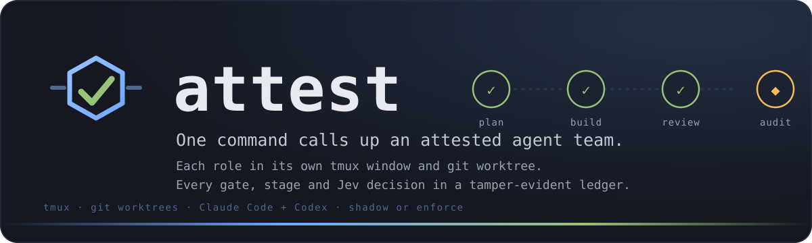
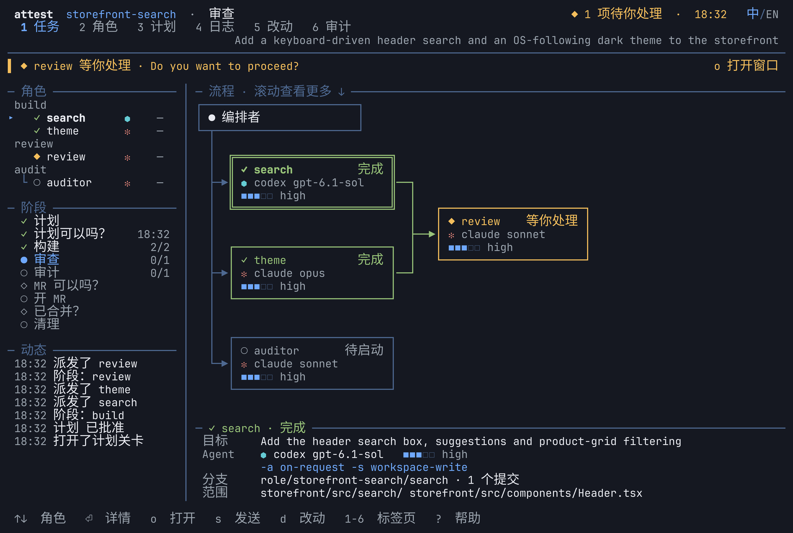
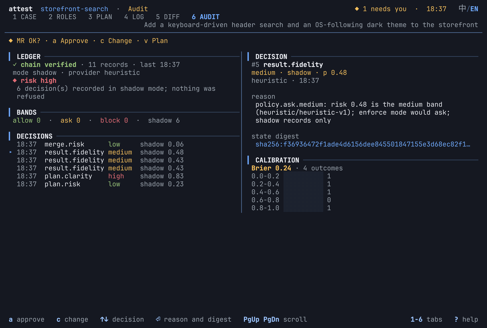
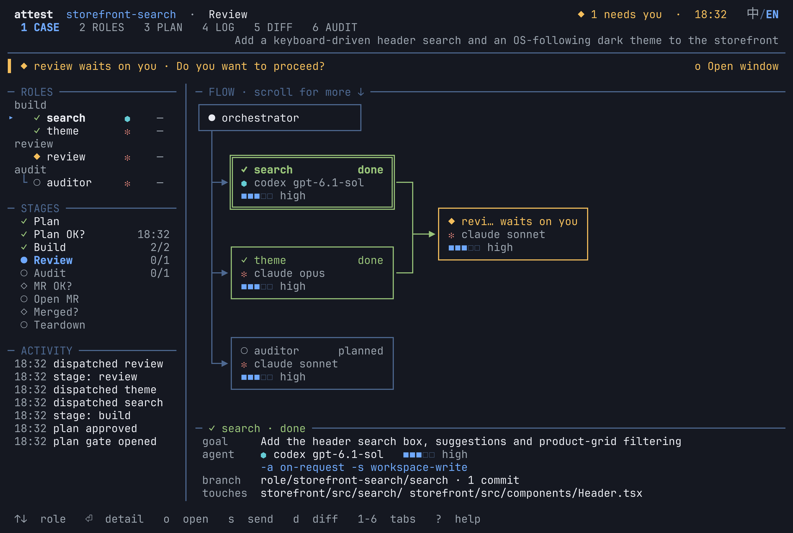

<p align="center">
  
</p>

<p align="center">
  <b>一个 agent 做计划，一支团队并行开工，只交付被人确认过的东西。</b><br>
  每个角色都有自己的 tmux 窗口和 git worktree，决策由 Jev/System One 决策层参与把关，
  并留下一份可发现篡改的审计账本。
</p>

<p align="center">
  <a href="README.md"></a>
  <a href="README.zh-CN.md"></a>
  <a href="docs/guide.zh-CN.md"></a>
  <a href="docs/jev-audit.zh-CN.md"></a>
</p>

Attest 0.1.0 · MIT · 运行在 tmux 里 · 支持 Claude Code 与 Codex · 不依赖云端服务

## 为什么是 Attest

- **看得见团队，随时能插手。** 每个角色都是真实的 Claude Code 或 Codex 会话，跑在
  自己的 tmux 窗口里。一块面板同时显示谁在干活、谁在等你、每个分支改了什么、
  角色声称了什么；点开任意角色的窗口就能旁观或直接回应。
- **先对齐，再动工。** 编排者写计划，你在面板里批准。每个角色从案件分支切出
  自己的 git worktree 与分支；计划里文件范围重叠，必须显式声明先后顺序。
- **不同 agent，同一道关卡。** Claude Code 与 Codex 可以混用，每个角色的模型、
  强度、权限独立设置。默认流程里有审查者逐分支检查，开 MR 前和清理前都会停下来
  等你确认。
- **决策可以事后审。** 可选的 Jev/System One 决策层会评估计划风险、角色边界、结果
  保真度、合并风险与清理安全性；每条决策写入哈希链账本，`attest audit verify`
  校验链，`attest audit report` 写出 MR 关卡所依据的证据。信号始终只是信号：
  账本不能授权合并。

<p align="center">
  
  <br>
  <sub><b>任务页</b>——两个构建者已完成，审查者正在等你，前面是审计阶段。
  截取自真实面板进程；生成方式见 <a href="tools/screenshot/">tools/screenshot</a>。</sub>
</p>

> **截图里哪些是真的。** 面板、CLI、git worktree、提交、运行日志与审计账本都是
> Attest 的真实输出；图中的 agent 会话是脚本替身（`tools/screenshot/demo/agent.mjs`），
> 这样无需登录 Claude Code 或 Codex 也能复现截图；角色与模型标签来自演示计划的
> adapter 字段。审计相关截图使用的是默认离线 `heuristic` 提供方，不是托管的 Jev API。

## 快速开始

需要 **macOS、Linux 或 WSL2**、**tmux**、**Node.js 20+**、**git**，以及已安装并登录的
**Claude Code 和/或 Codex**。

```sh
git clone <repo> && cd Attest
npm ci && npm run build && npm link   # Attest 0.1.0 尚未发布到 npm，从源码构建
attest setup                          # 为检测到的 harness 安装案件工作流
```

在**要修改的仓库里、tmux 中**打开 Claude Code 或 Codex，然后说：

```text
把这件事作为 attest 案件来做：给页头加一个搜索框，输入时即时过滤商品列表，
再加一套跟随系统设置的深色主题。
```

agent 会写好计划，并在旁边打开面板。看计划，按 **`a`** 批准或按 **`c`** 提出修改；
批准之后角色才会启动。

更偏终端的方式，也可以直接在要修改的仓库里跑：

```sh
attest up -m storefront-search --orch claude
```

它会创建案件 worktree、在其中启动编排者并打开面板。

## 从一个案件到一次合并

1. **一起做计划。** 编排者读代码，写出 `docs/cases/<case>/plan.md`：目标、原因、
   完成标准、不做的事、留给你的决策，以及角色划分（每个角色的 agent、模型、
   权限与 `touches`）。
2. **批准计划。** 面板上出现计划关卡。批准即采纳你那些决策的推荐项；选"修改"则把
   你的话发回编排者。之后任何计划或引用角色文本的改动，都需要重新批准。
3. **并行构建。** 相互独立的角色同时开窗、各自在自己的 worktree 里工作；有依赖的
   角色等前置角色 `done`。构建者在自己的分支上提交，并写一份结果文件供面板与
   CLI 读取。
4. **逐分支审查。** 审查者通常换一个模型，读 diff 和完成标准，给一轮修复机会，
   然后由编排者裁定。
5. **MR 之前先审计。** 审计阶段校验账本、记录结果相关的决策，并写出
   `docs/cases/<case>/audit.md`。`shadow` 模式只记录、不拒绝；`enforce` 模式下
   高风险会拦截、中风险会询问。
6. **由你把关交付。** 推送前先问 `mr-ok`。MR 由你本人合并，确认 `merged` 关卡后，
   `attest teardown` 才会移除案件的窗口与临时 worktree。

<p align="center">
  
  <br>
  <sub><b>计划关卡</b>——人批准时看到的就是这一帧：目标、原因、完成标准、每个角色的
  agent 与强度，以及批准即采纳的那些待定决策。</sub>
</p>

## 决策与账本

多数多 agent 工具停在"agent 说它做完了"。Attest 多问一句：*这件事该发生吗？
事后能证明当时决定了什么吗？*

计划里可选的 `audit:` 配置块会启用 Jev/System One 决策层：

```yaml
audit:
  mode: shadow          # shadow 只记录；enforce 才允许高风险拦截
  provider: heuristic   # 默认离线、确定；typesafe 才访问 API
  questions: [plan.risk, plan.clarity, role.boundary, result.fidelity, merge.risk, teardown.safety]
```

每条决策都追加进哈希链账本（`<git-common-dir>/attest/<case>/audit.jsonl`），事后
可以逐条核对：

```sh
attest audit verify          # OK <n> records，或 BROKEN at record <n>
attest audit report --write  # 案件摘要；写出 docs/cases/<case>/audit.md
attest audit show 3          # 单条决策的原因与状态摘要
attest audit outcome result.fidelity pass
attest audit calibrate       # 有结果样本后给出 Brier 分数与可靠性分箱
```

三条设计原则让这件事保持诚实。**确定性规则优先**：force push、破坏性命令、
机密路径、越出 `touches` 的写，直接由正则判定，根本不询问模型。**答案只是信号，
从不授权**：关卡、权限与审查仍然决定一切；提供方出错时 fail-safe（询问，绝不放
行）。**提供方由你选择**：默认是离线启发式；HTTP 提供方需要显式开启，且有大小、
超时与日志边界。

### 看它跑起来，以及审计截图用的是什么

截图与默认安装使用的是 `provider: heuristic`：它是同一套带类型决策契约背后的
确定性离线提供方，**不是**托管的 Jev 模型；每条决策都记录 `provider: heuristic`，
两者不会被混淆。下面是一段来自演示案件的删节运行记录：

```sh
$ attest gate plan "Approve the search and dark-theme plan" --no-wait -m storefront-search
Opened gate plan
$ attest audit verify -m storefront-search
OK 2 records
Verify record 2 appended.
$ attest audit report -m storefront-search
# Audit: storefront-search

- Chain: OK 3 records
- Mode: shadow · provider: heuristic
- Decisions: 2 · allow 0 · ask 0 · block 0 · shadow 2
- Bands: low 1 · medium 0 · high 1 · unknown 0
- Risk: high
- Verdict: 2 decision(s) recorded in shadow mode; nothing was refused
```

`enforce` 模式下 high 分会直接拦住关卡。把 `git push --force origin main` 写进角色
说明后，确定性预检会胜出，账本如实记录（两段输出之间重置过账本；路径与哈希有删节）：

```sh
$ ATTEST_JEV_MODE=enforce attest gate plan "Ship it?" --no-wait -m storefront-search
plan gate: audit plan.clarity: high 0.93 (heuristic) → block: policy.block.high: …
# exit 1
$ attest audit show 0 -m storefront-search
seq 0 · plan.risk · …
band high · action block · provider precheck · risk —
state sha256:…
reason precheck.force-push: state names a force push; the deterministic rule decides, the model is not consulted
```

一次真实托管运行（2026-11-15，key 只在运行时提供；账本与上面的启发式示例分开）
会记录版本化模型、耗时与 token 用量：

```sh
$ ATTEST_JEV_PROVIDER=typesafe ATTEST_JEV_API_KEY=… attest gate plan "Live Jev check" --no-wait -m storefront-search
Opened gate plan
$ attest audit show 0 -m storefront-search
band low · action shadow · provider typesafe/jev-1.14.0 · risk 0.12
latency 639 ms · tokens 2726 in / 20 out
$ attest audit show 1 -m storefront-search
band medium · action shadow · provider typesafe/jev-1.14.0 · risk 0.28
latency 250 ms · tokens 2762 in / 17 out
answers risk: score 0.28 (confidence 0.62)
```

<p align="center">
  
  <br>
  <sub><b>一次真实托管 Jev 决策</b>——2026-11-15 从真实面板截取：
  `provider: typesafe`、`model jev-1.14.0`、`plan.clarity` medium 0.28。key 只在运行时
  提供、从不落盘；与上面五张可复现截图不同，重拍这一张需要 TypeSafe 凭据。</sub>
</p>

要调用托管的 TypeSafe System One 端点：保持 `mode: shadow`，设置
`ATTEST_JEV_PROVIDER=typesafe` 与 `ATTEST_JEV_API_KEY`（可选
`ATTEST_JEV_BASE_URL`、`ATTEST_JEV_MODEL`），先用 `attest audit outcome` 记录几份
人工结论，等报告里的校准有意义后再切到 `enforce`。该提供方已对
`POST /v1/systemone`（`jev-1.14.0`）做过真实联调，脱敏证据见
[docs/dev/jev-live-verification.md](docs/dev/jev-live-verification.md)。请求/响应
契约、限制与完整命令参考见 [Jev 审计指南](docs/jev-audit.zh-CN.md)。

<p align="center">
  
  <br>
  <sub><b>审计页</b>——链状态、模式与提供方、风险结论、分级计数、每条决策及其概率、
  所选决策的原因与状态摘要；记录结果之后还会显示校准条。</sub>
</p>

完整设计见 [docs/jev-audit.zh-CN.md](docs/jev-audit.zh-CN.md)：带类型的决策协议、
策略、信任边界、账本能证明与不能证明什么，以及公开证据——包括校准与对抗攻击方面
必须说明的保留意见。

## 面板

| 页面 | 内容 |
| --- | --- |
| `1 CASE` 任务 | 角色实时状态、阶段、动态、团队流程，以及所选角色的详情与实时窗口。打开的关卡、每个等你的角色都排在顶部。 |
| `2 ROLES` 角色 | 每个角色一张卡片：agent、模型、强度、权限、分支、提交、改动文件、结果摘要。 |
| `3 PLAN` 计划 | 渲染后的计划与它的问题，加上关卡所用的摘要。 |
| `4 LOG` 日志 | 本次运行的全部事件，最新在前，可展开字段。 |
| `5 DIFF` 改动 | 每个角色的改动文件树，含 hunk 与缩略图。 |
| `6 AUDIT` 审计 | 账本：链、模式/提供方、风险、分级计数、决策、原因与校准。 |

按键：`1`–`6` 或 `Tab` 切页，`↑↓`/`j k` 选择，`Enter` 展开详情，`o` 打开角色窗口，
`s` 给它发消息，`d` 跳到它的 diff，`v` 看计划，`a`/`c` 回应关卡，`?` 帮助，
`q` 退出。`中/EN`（或 `L`）切换面板语言，选择保存在
`~/.config/attest/settings.json`；角色窗口与 agent 的书写语言都跟随它。tmux 传递
鼠标事件时，点击也有效。

<p align="center">
  
  <br>
  <sub><b>角色页</b>——同一次运行，一角色一卡片。harness 报告 ctx 与 token 时才显示；
  已写结果的角色即使窗口空闲也算完成。</sub>
</p>

<p align="center">
  
  <br>
  <sub><b>English UI</b>——同一个面板的英文界面。界面语言只影响人读的文本；角色名、
  分支、命令，以及 attest 要读回来的内容（标题、YAML、`status:`）保持英文。</sub>
</p>

## 命令

所有命令都接受 `-m, --case <name>`；不带时作用于当前 pane 绑定的案件，否则作用于
当前检出的 `case/<name>` 分支。退出码：`0` 成功，`1` 被拒绝（附原因），`2` 用法错误。

| 命令 | 作用 |
| --- | --- |
| `attest setup [--remove]` | 为检测到的 harness 安装或移除案件工作流 |
| `attest case new <name> [--base <ref>]` | 创建 `case/<name>` 的 worktree 与计划模板，绑定当前 pane，打开面板 |
| `attest open [--planning] [-m case]` | 在 agent 旁边打开案件面板 |
| `attest up -m <case> [--orch claude\|codex]` | 创建案件，在 worktree 里启动编排者，打开面板 |
| `attest check [case\|folder\|plan]` | 检查计划与仓库里的 agent 适配器 |
| `attest approve [-m case]` | 在终端里批准计划（面板里按 `a` 等价） |
| `attest gate <id> ["question"] [--no-wait]` | 在面板里向人提问 |
| `attest stage <id>` | 移动阶段条（id 见工作流的 `stages.yaml`） |
| `attest dispatch <role>` | 打开一个角色：worktree、分支、brief、窗口 |
| `attest status [--json] [--watch]` | 每个角色的状态、提交、超出 `touches` 的文件、结果 |
| `attest send <role> <text…>` | 角色就绪时向它的窗口输入 |
| `attest wait --role <r> [--ready] \| --gate <id> [--timeout s]` | 等待结果、就绪或关卡回答 |
| `attest close <role> \| --all` | 关闭 attest 打开的 pane；worktree 与分支保留 |
| `attest panel [--once] [--plain] [--no-anim] [--width N --height N]` | 实时面板 |
| `attest audit verify\|report\|show\|outcome\|calibrate` | 审计账本：校验、报告、查看、记录结果、校准 |
| `attest teardown [--force]` | 关卡允许后移除案件 pane、角色 worktree 与分支 |

## Agent 与适配器

内置 **Claude Code** 与 **Codex**。适配器描述如何启动 agent、如何传模型与强度、
如何固定权限、如何读屏；放在 `~/.config/attest/agents/<name>.yaml` 或
`<repo>/.attest/agents/<name>.yaml`（仓库里的优先）。每个角色的 `flags` 必须固定其
agent 的权限——Claude Code 用 `--permission-mode acceptEdits`，Codex 用
`-a on-request -s workspace-write`——所以角色不会继承你 shell 的权限模式。
Claude Code 角色会装上生命周期钩子（`UserPromptSubmit`、`PermissionRequest`、
`PostToolBatch`、`Stop`、`Notification`）和状态栏以读取上下文；Codex 角色则读它
自己的会话日志。适配器字段与回退规则见
[使用指南](docs/guide.zh-CN.md#agent-适配器)。

## 依赖选择

通用工作交给成熟库，每一个都有明确用途：`yaml` 解析计划、`zod` 校验适配器与
决策响应、`execa` 执行进程、`picocolors` 终端着色、`string-width` 计算显示宽度、
`p-retry` 对有界幂等调用重试。属于产品本身的部分保持自研，因为它们的精确输出就是
契约：单元格画布、动效与面板渲染（纯文本 golden 测试）、事件日志折叠与实时状态
读取、哈希链账本，以及带类型的决策协议。见
[docs/dev/contracts.md](docs/dev/contracts.md#5-library-policy) 与 [NOTICE](NOTICE)。

## 已知限制

- **账本可发现篡改，但不是不可篡改。** 它是本地的只追加链；能整体重写文件的人
  可以替换它。它没有签名，也没有外部时间戳。
- **启发式不是 Jev。** 默认提供方是 Attest 自己的确定性打分，标记为
  `provider: heuristic`。校准按案件、根据记录的结果计算，初期很稀疏；
  `audit calibrate` 会直说样本不足，而不是猜。
- **截图不是厂商会话。** 面板帧是真实 CLI 输出，但其中的 agent 二进制是脚本替身，
  审计决策来自离线启发式。它们展示的是产品界面，不是真实负载下的 Claude Code、
  Codex 或托管 Jev 模型。
- **决策模型会被攻击。** 公开研究表明提示注入与对抗后缀可以操纵 Jev 类决策。
  Attest 把指令排除在状态之外、优先确定性规则、失败即安全——但不要把机密或不可信
  内容送进远程提供方。
- **读屏只是回退。** 内置角色的回合由 agent 自己的信号决定（钩子或会话日志），
  读屏只用于区分"等待对话框"与"正在工作"；无法识别的画面是 `unknown`，绝不会被
  输入文字。
- **一台机器、一个用户。** 角色共享案件的 refs 与 objects；这允许提交，但不是角色
  之间的隔离。边界是 tmux 与 git worktree，不是沙箱。
- **计划必须批准，批准必须在终端里。** 面板 `a` 或 `attest approve`；CLI 不会替你
  推送或合并。

## 开发

```sh
git clone <repo> && cd Attest
npm ci
npm run build && npm link   # 把你构建的 attest 放到 PATH
./check.sh                  # 类型检查、构建、全部测试、身份扫描
```

`./check.sh` 会跑 `tsc`、身份扫描和完整的 `node:test` 套件，包括面板 golden 与
真实 tmux 集成测试（没有 tmux 时自动跳过）。要有意重生成面板 golden：
`UPDATE_GOLDENS=1 node --test tests/draw.node.mjs`，然后阅读 diff。`docs/media/`
里的截图由 [tools/screenshot](tools/screenshot/README.md) 生成：tmux 里真实的
`attest panel` 进程，经 `tmux capture-pane -ep` 抓取、渲染为 PNG。参与贡献见
[CONTRIBUTING.md](CONTRIBUTING.md)。

## 延伸阅读

- [使用指南](docs/guide.zh-CN.md)——计划格式、全部命令与选项、面板操作、适配器、
  文件位置、限制。
- [Jev 审计](docs/jev-audit.zh-CN.md)——带类型的决策、策略、账本、校准、对抗风险、
  来源。
- [路线图](ROADMAP.md) · [更新日志](CHANGELOG.md) · [安全](SECURITY.md) ·
  [贡献](CONTRIBUTING.md)

MIT 许可。第三方声明见 [NOTICE](NOTICE)。Attest 是独立实现，与 TypeSafe AI
没有隶属或背书关系。
